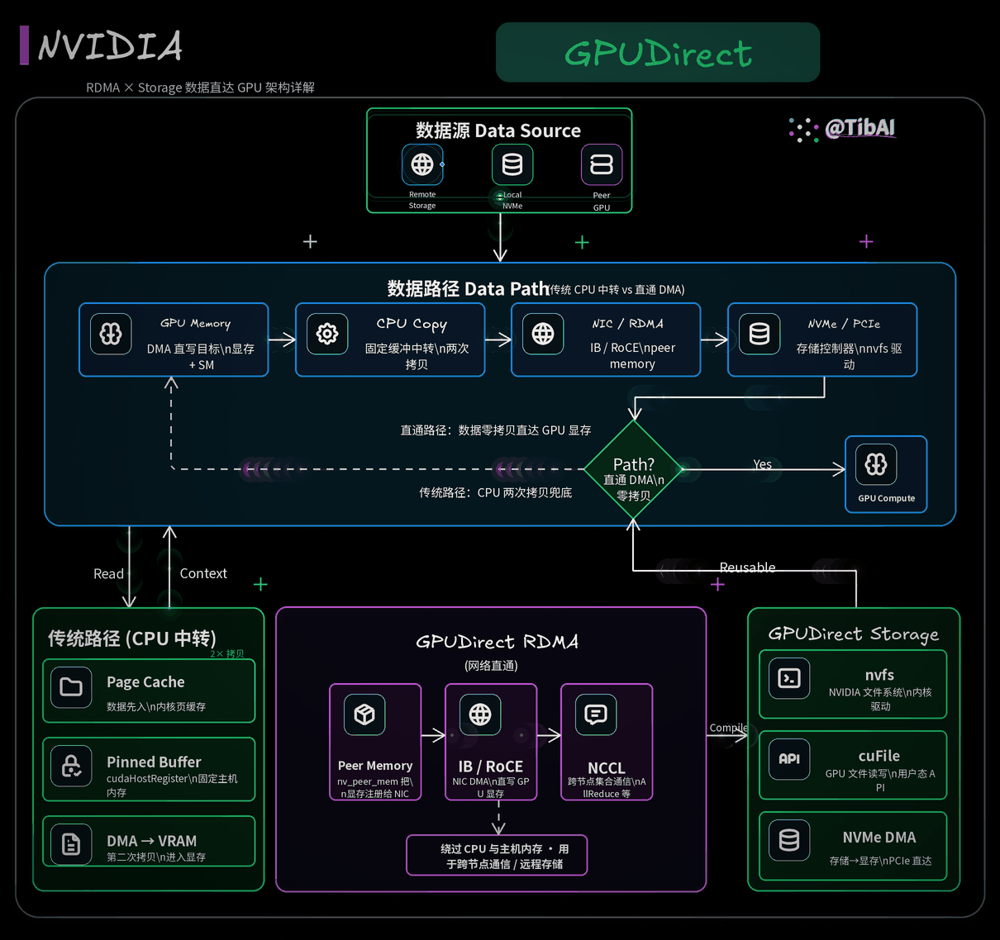

# NVIDIA GPUDirect RDMA 与 GPUDirect Storage 技术详解

## 架构、工作原理、软件栈、部署条件、性能分析与实际应用

**版本说明：2026 年 8 月**

---

# 摘要

随着高性能计算（HPC）、大模型训练、生成式 AI、科学计算和 GPU 数据分析系统不断扩大，GPU 的计算能力增长速度已经显著超过传统主机 I/O 子系统的数据供应能力。

现代 GPU 可以在极短时间内处理数十甚至数百 GB 数据，但传统系统中的网络和存储数据通常需要先进入 Host DRAM，再由 GPU DMA Engine 将数据搬入显存。由此产生的 Host Memory Staging、CPU 软件处理、NUMA 跨节点访问以及 PCIe 往返流量，会逐渐成为整个 GPU 系统的数据路径瓶颈。

NVIDIA GPUDirect 是针对这一问题建立的一系列数据移动技术。其中最重要的两个组成部分是：

| 技术 | 主要解决的问题 |
|---|---|
| GPUDirect RDMA | NIC、DPU、采集卡等 PCIe 设备与 GPU 显存之间直接进行 DMA/RDMA |
| GPUDirect Storage（GDS） | 本地或远程存储与 GPU 显存之间建立直接 I/O 数据路径 |

GPUDirect RDMA 最早随 Kepler GPU 和 CUDA 5.0 引入，其核心思想是在第三方 PCIe 设备与 GPU Memory 之间建立直接 Peer-to-Peer 数据路径，从而避免数据必须经过 Host Memory。

GPUDirect Storage 则将类似思想扩展到存储系统，通过 cuFile、Linux PCI P2PDMA、DMA-BUF、`nvidia-fs` 以及支持 RDMA 的分布式文件系统，让 NVMe、NIC 或其他 Storage DMA Engine 可以直接向 GPU Memory 读写数据。

需要特别强调的是：

> GPUDirect 并不意味着 CPU 从系统中消失，也不意味着“数据完全没有发生拷贝”。

其真正意义是：

> **尽可能消除 Host DRAM 作为数据中转站，让数据面由 PCIe/RDMA/DMA 设备直接进入 GPU Memory，从而减少 CPU Memory Traffic、软件处理和不必要的数据搬运。**

---

# 架构图



---

# 1. 为什么需要 GPUDirect

## 1.1 GPU 算力增长带来的数据供应问题

传统 CPU 系统通常围绕 Host DRAM 构建：

```text
Storage
   │
   ▼
Host Memory
   │
   ▼
CPU
```

加入 GPU 后，传统架构变成：

```text
Storage / NIC
      │
      ▼
 Host Memory
      │
      ▼
     GPU
```

也就是说，几乎所有外部数据首先进入 Host Memory。

这种设计在 GPU 算力较低时问题并不明显，但随着 GPU 数量增加，会逐渐出现：

```text
GPU 计算能力
     ↑↑↑↑↑↑

CPU Memory Bandwidth
     ↑↑

Storage / Network
     ↑↑↑
```

GPU 很可能最终不是“算不动”，而是：

> **没有数据可算。**

在大规模系统中，这种现象通常被称为 GPU starvation。

---

# 2. 理解 GPUDirect 前必须掌握的几个概念

## 2.1 DMA

DMA（Direct Memory Access）的核心作用是允许设备在不需要 CPU 执行逐字节 memcpy 的情况下直接搬运数据。

例如传统 NVMe 读取：

```text
NVMe Controller
      │
      │ DMA
      ▼
Host DRAM
```

CPU 主要完成：

```text
提交 IO
建立描述符
处理中断 / Completion
管理内存
```

真正的数据传输由 NVMe Controller 的 DMA Engine 完成。

因此：

> “CPU 不参与数据搬运”和“数据不经过 CPU Memory”是完全不同的两个概念。

传统 DMA 虽然不需要 CPU 执行 memcpy，但数据仍然通常落在 Host DRAM。

## 2.2 PCIe Peer-to-Peer

正常 PCIe DMA：

```text
PCIe Device
     │
     ▼
Host Memory
```

PCIe P2P：

```text
PCIe Device A
     │
     ▼
PCIe Device B
```

例如：

```text
NIC ─────────► GPU
```

或者：

```text
NVMe ────────► GPU
```

Linux 上游内核提供 PCI P2PDMA 基础设施，允许 PCIe Device Driver 注册 P2P Memory，并让其他兼容 PCIe Device 对该 Memory 发起 DMA。

## 2.3 PCIe BAR

PCIe 设备通过 BAR（Base Address Register）将设备内部资源映射到 PCIe Address Space。

对于 GPU：

```text
GPU HBM / VRAM
       │
       ▼
     BAR1
       │
       ▼
PCIe Address Space
```

NIC 或 NVMe Controller 无法理解 CUDA Virtual Address。设备最终需要的是 PCIe Bus Address。

GPUDirect 软件栈的一个重要任务，就是完成：

```text
GPU Virtual Address
        ↓
GPU Allocation
        ↓
Pinned GPU Pages
        ↓
PCIe / DMA Mapping
        ↓
Device DMA Address
```

## 2.4 BAR1

GPU 的 BAR1 Aperture 是外部 PCIe Device 访问 GPU Memory 的重要窗口。

概念上：

```text
GPU HBM
┌───────────────────────────────┐
│                               │
│             Data              │
│                               │
└───────────────────────────────┘
               ▲
               │
             BAR1
               ▲
               │
       NIC / NVMe DMA
```

BAR1 并不一定等于全部 GPU HBM 大小。

## 2.5 Pinned Memory

DMA 要求目标内存在 DMA 操作执行期间不能随意被迁移或释放，因此需要 Memory Pinning。

CPU Memory 通常通过 Linux 的 `get_user_pages()` 等机制锁定。GPU Memory 则需要 NVIDIA Driver、DMA-BUF 或其他 Peer Memory 机制暴露稳定的 DMA Mapping。

---

# 3. GPUDirect RDMA

## 3.1 GPUDirect RDMA 是什么

GPUDirect RDMA 允许第三方 PCIe Device，例如：

- ConnectX NIC
- BlueField DPU
- InfiniBand HCA
- Ethernet/RoCE NIC
- FPGA
- Video Capture Card

直接 DMA 到 NVIDIA GPU Memory。

传统网络发送路径：

```text
GPU A
 │
 │ D2H
 ▼
Host RAM
 │
 │ NIC DMA
 ▼
 NIC
 │
══════════ Network ══════════
 │
 NIC
 │
 │ DMA
 ▼
Host RAM
 │
 │ H2D
 ▼
GPU B
```

GPUDirect RDMA：

```text
GPU A
 │
 ▼
 NIC
 │
══════════ Network ══════════
 │
 NIC
 │
 ▼
GPU B
```

这里真正被消除的是 Host Memory Staging。

## 3.2 为什么 RDMA 本身还不够

普通 RDMA 已经可以：

```text
NIC → Host Memory
```

但是 NIC 默认并不知道 GPU Virtual Address 对应什么 PCIe Address。

因此必须解决：

```text
CUDA pointer
      ↓
GPU memory allocation
      ↓
DMA mapping
      ↓
NIC Memory Region
```

GPUDirect RDMA 本质上就是：

> **让 RDMA Device 能够将 GPU Memory 注册为合法 DMA / RDMA Memory Region。**

## 3.3 GPUDirect RDMA 软件栈

```text
Application
     │
     ▼
NCCL / MPI / UCX / NVSHMEM
     │
     ▼
libibverbs / RDMA Core
     │
     ▼
NIC Driver
     │
     ├──────── DMA-BUF
     │
     └──────── legacy nvidia-peermem
     │
     ▼
NVIDIA GPU Driver
     │
     ▼
GPU Memory
```

现代实现应优先关注 DMA-BUF；`nvidia-peermem` 更适合作为 legacy 路径理解。

## 3.4 GPU Memory Registration

逻辑流程：

```text
cudaMalloc()
    │
    ▼
GPU Virtual Address
    │
    ▼
识别 Pointer Type
    │
    ▼
Pin GPU Allocation
    │
    ▼
建立 DMA Mapping
    │
    ▼
NIC 创建 MR / MKEY
```

Memory Registration 本身有成本，因此实际通信库通常会维护 Registration Cache，避免频繁 register / deregister。

## 3.5 PCIe 拓扑为什么极其重要

最佳：

```text
           PCIe Switch
           /        \
         GPU        NIC
```

较差：

```text
GPU
 │
CPU Root Complex
 │
NIC
```

更差：

```text
GPU
 │
CPU0
 │
UPI / Inter-socket Link
 │
CPU1
 │
NIC
```

所以“GPU 和 NIC 都插在机器上”并不代表一定存在高性能 GPUDirect RDMA 路径。

## 3.6 IOMMU

IOMMU 如果对设备 DMA 地址进行不一致转换，可能破坏 P2P Mapping。

因此实际部署时不能简单套用“必须 `iommu=pt`”这种单一结论，而应遵循 NVIDIA 与服务器 OEM 对具体平台的 qualification。

## 3.7 Memory Ordering

如果 NIC 正在：

```text
RDMA WRITE → GPU Buffer
```

同时 GPU Kernel 正在读取同一 Buffer，就不能假设 NIC Completion 自动等于 GPU 一定观察到完整且有序的数据。

正确做法需要 CUDA / Communication Runtime 提供同步与 Memory Ordering 保证。

## 3.8 GPUDirect RDMA 与 NCCL

大多数 AI 开发者不会直接操作 verbs API，而是：

```text
PyTorch Distributed
        │
        ▼
       NCCL
        │
        ▼
Network Transport
        │
        ▼
GPUDirect RDMA
```

这也是 GPUDirect RDMA 实际普及度远高于“直接调用相关 API 的开发者人数”的原因。

---

# 4. GPUDirect Storage

## 4.1 为什么需要 GDS

GPUDirect RDMA 主要解决 Network Device ↔ GPU，GDS 则处理 Storage ↔ GPU。

传统文件读取：

```text
Storage
   │
   ▼
Host Memory
   │
   ▼
GPU
```

GDS 的目标：

```text
Storage ─────────► GPU
```

## 4.2 三种 I/O 路径对比

### Buffered I/O

```text
SSD
 │ DMA
 ▼
Kernel Page Cache
 │ CPU memcpy
 ▼
User Buffer
 │ GPU DMA
 ▼
GPU Memory
```

### Direct I/O

```text
SSD
 │ DMA
 ▼
User Buffer
 │ GPU DMA
 ▼
GPU
```

### GPUDirect Storage

```text
SSD / NIC
     │
     │ DMA / RDMA
     ▼
GPU Memory
```

因此 GDS 所谓 Zero-Copy 更准确的解释是：

> **Zero Host Staging Copy，而不是“0 次数据搬运”。**

## 4.3 GDS 软件架构

```text
Application
     │
     ▼
   cuFile
  libcufile
     │
 ┌───┼───────────────────────┐
 │   │                       │
 ▼   ▼                       ▼
P2PDMA                  nvidia-fs
 │                           │
 │                           │
Linux PCI P2P       Vendor / Legacy Path
 │                           │
 └─────────────┬─────────────┘
               ▼
          Storage Driver
               │
               ▼
        NVMe / NIC / FS
               │
               ▼
          GPU Memory
```

当无法建立 Direct Path 时，会进入 Compatibility Mode，通过 Host Bounce Buffer 完成传输。

## 4.4 libcufile

`libcufile.so` 是 GDS 的核心用户态库，常见接口包括：

- `cuFileRead()`
- `cuFileWrite()`
- Buffer Registration API
- Batch API
- Stream / Async API
- Driver API

## 4.5 nvidia-fs

传统 GDS 中，`nvidia-fs.ko` 是协调 Filesystem、Storage Driver、NVIDIA Driver 与 GPU Memory Mapping 的内核侧组件。

它不是 SSD Driver，而更像 GDS Kernel Data Path 的协调层。

## 4.6 Linux PCI P2PDMA

现代 Linux 上游 PCI P2PDMA 基础设施让 GDS 可以逐步从：

```text
Custom NVMe Patch
+
nvidia-fs
```

迁移到：

```text
Upstream NVMe
+
Linux PCI P2PDMA
```

这显著降低了本地 NVMe GDS 的部署复杂度。

## 4.7 三类主要执行模式

| Mode | 数据路径 | 特点 |
|---|---|---|
| `p2pdma` | Linux PCI P2PDMA | 新的 upstream 方向 |
| `nvfs` | `nvidia-fs` | 传统/厂商集成路径 |
| `compat` | Host Bounce Buffer | 兼容路径 |

判断 GDS 是否真正直通，不能只看 `cuFileRead()` 成功，必须确认实际执行路径。

## 4.8 本地 NVMe GDS 数据路径

```text
              PCIe Switch
             /           \
          NVMe            GPU
            │              ▲
            └──── DMA ─────┘
```

流程可抽象为：

```text
cuFileRead
    │
    ▼
解析文件 block
    │
    ▼
Pin GPU Buffer
    │
    ▼
建立 P2P DMA Mapping
    │
    ▼
NVMe PRP / SGL
    │
    ▼
NVMe DMA → GPU
```

## 4.9 Remote Storage GDS

理想路径：

```text
Storage Server
      │
      │ Network
      ▼
     NIC
      │
      │ GPUDirect RDMA
      ▼
     GPU
```

这里 GDS 和 GPUDirect RDMA 可以同时出现。

## 4.10 O_DIRECT 是否必须

现代 GDS 中，`O_DIRECT` 已不再是调用 cuFile API 的绝对必要条件。

更准确地说：

```text
O_DIRECT
    ≠
cuFile API 必须条件
```

但它依然有助于获得可预测的 Direct I/O 行为和性能。

## 4.11 Alignment

高性能路径通常要求 File Offset、Buffer Address、Transfer Size 尽量满足 Block/Page Alignment。

非对齐 I/O 可能触发额外处理、Bounce Buffer 或 Compatibility Path。

## 4.12 GDS Compatibility Mode

Compatibility Mode 的存在保证了 cuFile API 的可移植性，但也意味着：

```text
程序运行成功
        ≠
GDS Direct Path 生效
```

部署时应结合：

- `gdscheck`
- cuFile stats
- tracepoint
- benchmark

确认实际路径。

---

# 5. cuFile 基本示例

```cpp
#include <fcntl.h>
#include <unistd.h>
#include <cstring>
#include <iostream>

#include <cuda_runtime.h>
#include <cufile.h>

int main()
{
    const char* filename = "data.bin";
    size_t size = 1024ULL * 1024 * 1024;

    void* gpu_buffer = nullptr;

    CUfileError_t status = cuFileDriverOpen();
    if (status.err != CU_FILE_SUCCESS) {
        std::cerr << "cuFileDriverOpen failed\n";
        return 1;
    }

    if (cudaMalloc(&gpu_buffer, size) != cudaSuccess) {
        std::cerr << "cudaMalloc failed\n";
        cuFileDriverClose();
        return 1;
    }

    int fd = open(filename, O_RDONLY | O_DIRECT);
    if (fd < 0) {
        std::cerr << "open failed\n";
        cudaFree(gpu_buffer);
        cuFileDriverClose();
        return 1;
    }

    CUfileDescr_t desc {};
    desc.handle.fd = fd;
    desc.type = CU_FILE_HANDLE_TYPE_OPAQUE_FD;

    CUfileHandle_t handle;

    status = cuFileHandleRegister(&handle, &desc);
    if (status.err != CU_FILE_SUCCESS) {
        std::cerr << "cuFileHandleRegister failed\n";
        close(fd);
        cudaFree(gpu_buffer);
        cuFileDriverClose();
        return 1;
    }

    status = cuFileBufRegister(gpu_buffer, size, 0);

    ssize_t bytes = cuFileRead(
        handle,
        gpu_buffer,
        size,
        0,
        0
    );

    if (bytes < 0) {
        std::cerr << "cuFileRead failed\n";
    }

    cuFileBufDeregister(gpu_buffer);
    cuFileHandleDeregister(handle);

    close(fd);
    cudaFree(gpu_buffer);
    cuFileDriverClose();

    return 0;
}
```

---

# 6. GPUDirect RDMA 与 GDS 的关系

```text
GPUDirect RDMA
=
Device / Network ↔ GPU Memory

GPUDirect Storage
=
Storage I/O ↔ GPU Memory
```

本地 NVMe：

```text
NVMe
 │
 │ PCIe P2P DMA
 ▼
GPU
```

远程 Storage：

```text
Storage
 │
 ▼
NIC
 │
 │ GPUDirect RDMA
 ▼
GPU
```

因此远程 Storage GDS 往往同时依赖 GDS、RDMA 和 GPUDirect RDMA。

---

# 7. GDS 到底有没有用

答案是：

> **有用，但高度依赖 Workload。**

GDS 只优化 Storage ↔ GPU 的数据路径。

如果瓶颈不在那里，端到端性能提升就不会明显。

---

# 8. First/Last Touch 原则

一个非常实用的判断方式是：

> 数据从 Storage 出来以后，第一个真正处理它的是不是 GPU？

非常适合：

```text
Parquet
   ↓
GPU
   ↓
cuDF
```

或者：

```text
Checkpoint
   ↓
GPU
```

不太适合：

```text
JPEG
  ↓
CPU decode
  ↓
CPU augmentation
  ↓
GPU
```

因此 GDS 最自然的模式是：

```text
Storage
   ↓
GPU
   ↓
GPU Compute
```

或者：

```text
GPU Compute
   ↓
GPU
   ↓
Storage
```

---

# 9. 为什么普通 PyTorch Training 不一定受益

典型流程：

```text
Storage
   ↓
PyTorch DataLoader
   ↓
CPU Worker
   ↓
JPEG Decode
   ↓
Augmentation
   ↓
Pinned Host Memory
   ↓
GPU
```

瓶颈可能在：

- JPEG decode
- Python worker
- metadata
- small files
- tokenization
- augmentation

而不是 SSD → RAM。

因此普通训练通常应该优先优化：

- Data Format
- Batch
- Prefetch
- Worker 数量
- Decode
- Caching
- Data Sharding
- Local NVMe
- DALI

之后再判断是否需要 GDS。

---

# 10. Page Cache 为什么可能让 GDS 没优势

如果：

```text
Dataset = 300 GB
Host RAM = 1 TB
```

第一个 Epoch：

```text
SSD → DRAM → GPU
```

后续 Epoch：

```text
Page Cache → GPU
```

此时强行从 SSD 直接读取不一定比 DRAM → GPU 更快。

因此 GDS 更适合：

```text
Dataset >> RAM
```

或者 Streaming Workload。

---

# 11. 大模型 Checkpoint

大规模模型训练中的 Checkpoint 是 GDS 很现实的使用场景。

传统保存：

```text
GPU
 ↓
Host RAM
 ↓
Filesystem
```

恢复：

```text
Filesystem
 ↓
Host RAM
 ↓
GPU
```

GDS 可以让：

```text
GPU ←──── Storage
```

减少 Host Staging。

对于大量 GPU、TB 级 Checkpoint 和频繁保存/恢复，这种优化可能具有明显系统价值。

---

# 12. Model Loading / Inference

推理系统同样存在：

```text
Model Weights
    ↓
Storage
    ↓
GPU
```

如果模型达到数百 GB，并需要同时启动大量 Replica，Storage Bandwidth、Network Bandwidth、Host Memory Bandwidth 与 GPU Load Time 都会影响扩容速度。

GPU-direct Model Loading 因而也是 GDS 很值得关注的方向。

---

# 13. GPU 数据分析

GPU-native ETL 是 GDS 的理想场景：

```text
Parquet
   │
   ▼
GPU HBM
   │
   ▼
cuDF
   │
   ▼
filter
groupby
join
sort
```

整个 Payload 生命周期都可以保持在 Storage ↔ GPU 之间，不必经过 CPU 处理。

---

# 14. GDS 生态

常见文件系统和存储方向包括：

- EXT4
- XFS
- Lustre / DDN EXAScaler
- IBM Spectrum Scale
- WekaFS
- BeeGFS
- NFS over RDMA
- 云端并行文件系统
- 高性能全闪存 Storage

常见上层软件包括：

- RAPIDS cuDF
- DALI
- MONAI
- Parabricks
- NIXL
- 部分 PyTorch GDS 接口与集成

---

# 15. GDS 使用普及度应该怎样理解

目前没有可靠公开统计能证明“多少比例 AI Cluster 使用 GDS”。

更合理的判断：

| 技术 | 普及程度 |
|---|---|
| NCCL | 极高 |
| GPUDirect RDMA | 大型 GPU Cluster 中非常普遍 |
| NVLink / NVSwitch | 多 GPU 高端系统普遍 |
| GPUDirect Storage | 专业 Storage / HPC / AI Infra 场景逐渐增加 |
| 应用直接调用 cuFile | 相对少 |
| Framework 间接使用 GDS | 越来越重要 |

所以：

> **GPUDirect RDMA 已经属于大型分布式 GPU 集群的基础通信能力之一，而 GDS 更像专业 I/O 基础设施能力。**

---

# 16. 性能不能简单写成“2～8 倍”

性能高度依赖：

- PCIe topology
- NVMe quantity
- NIC bandwidth
- storage backend
- IO size
- queue depth
- alignment
- GPU count
- CPU memory bandwidth
- filesystem
- page cache
- NUMA
- ACS
- IOMMU

更科学的说法：

> GDS 可以消除 Host Staging，并使端到端 I/O 更接近 Storage、NIC 和 PCIe 拓扑本身允许的物理性能上限；实际提升必须根据具体 Workload Benchmark。

---

# 17. PCIe Topology 与 Affinity

对 GDS 来说，GPU/NVMe/NIC Affinity 非常重要。

例如：

```text
NVMe0 → GPU0
NVMe1 → GPU1
NVMe2 → GPU2
NVMe3 → GPU3
```

通常比所有存储设备都跨 Root Complex 访问同一 GPU 更合理。

Remote Storage 同样应该关注：

```text
NIC0 → GPU0-3
NIC1 → GPU4-7
```

---

# 18. ACS

PCIe ACS 可能把 P2P Traffic 强制向上游 Root Complex 转发：

```text
Device
  ↓
Root Complex
  ↓
Device
```

而不是理想路径：

```text
Device
  ↓
PCIe Switch
  ↓
Peer Device
```

所以 ACS 会直接影响 P2P 性能甚至可用性。

但 ACS 同时涉及 Virtualization、Isolation 和 Security，不应该为了 Benchmark 随便关闭。

---

# 19. IOMMU

GDS 与 GPUDirect RDMA 都对 IOMMU 配置敏感。

不能把某个单一参数当成所有平台通用答案。

生产环境应结合：

- CPU 平台
- GPU 型号
- NVIDIA Driver
- Server OEM
- Virtualization
- Security Requirements

进行 qualification。

---

# 20. 如何判断是否真正使用 GDS

常用工具：

```bash
/usr/local/cuda-<version>/gds/tools/gdscheck.py -p
```

重点关注：

- GPU
- Filesystem
- NVMe
- RDMA
- DMA-BUF
- ACS
- IOMMU
- P2PDMA
- NVFS
- Compatibility Mode

如果只有：

```text
compat
```

那么数据仍经过 Host Bounce Buffer。

---

# 21. GDS Benchmark 应该怎么做

至少比较：

| 测试 | 目的 |
|---|---|
| Storage → Host | Storage baseline |
| Host → GPU | PCIe/H2D baseline |
| Storage → Host → GPU | Traditional pipeline |
| Storage → GPU compat | cuFile compatibility |
| Storage → GPU GDS | 真正 Direct Path |
| Cached Host → GPU | Page Cache 场景 |

同时记录：

- Storage GB/s
- GPU GB/s
- CPU utilization
- Host Memory bandwidth
- IOPS
- Latency
- GPU utilization
- PCIe throughput
- NUMA traffic

---

# 22. 大 I/O 与小 I/O

小 I/O 更容易受：

- API overhead
- IOPS
- Queue submission
- Filesystem metadata
- Latency

影响。

大 I/O 更容易受：

- PCIe Bandwidth
- Storage Bandwidth
- NIC Bandwidth
- BAR Mapping

限制。

所以 GDS Benchmark 必须覆盖真实 I/O Size，而不是只测一个 1 GB Sequential Read。

---

# 23. Zero Copy 的正确理解

错误理解：

```text
数据没有发生 Copy
```

实际：

```text
NIC DMA → GPU
```

和：

```text
NVMe DMA → GPU
```

仍然都在移动数据。

Zero Copy 更准确地说是：

> **不再经过多余的 Host Intermediate Copy。**

即：

```text
NIC → Host → GPU
```

变成：

```text
NIC → GPU
```

---

# 24. CPU Offload 的正确理解

GPUDirect 后，Data Plane 可以绕过 CPU Memory。

但 CPU 仍可能负责：

- API 调用
- Queue Submission
- Memory Registration
- Connection Management
- Filesystem Metadata
- Completion Processing
- Scheduling
- Error Handling
- Control Plane

所以 CPU Offload 不等于 CPU Utilization = 0%。

---

# 25. GPUDirect RDMA 与 NVLink / NVSwitch

GPUDirect RDMA 主要处理：

```text
NIC / PCIe Device ↔ GPU
```

NVLink / NVSwitch 主要处理：

```text
GPU ↔ GPU
```

两者是互补关系。

典型节点：

```text
GPU0 ═══ NVLink ═══ GPU1
 │
 │ PCIe
 ▼
NIC
 │
 │ GPUDirect RDMA
 ▼
Network
```

---

# 26. 一台现代 GPU Server 的完整数据路径

```text
                        ┌─────────────┐
                        │ Remote      │
                        │ Storage     │
                        └──────┬──────┘
                               │
                             RDMA
                               │
                        ┌──────▼──────┐
                        │ NIC / DPU   │
                        └──────┬──────┘
                               │
                     GPUDirect RDMA
                               │
               ┌───────────────▼───────────────┐
               │            GPU0               │
               │             HBM               │
               └───────┬──────────────┬────────┘
                       │              │
                     NVLink         NVLink
                       │              │
                    ┌──▼──┐        ┌──▼──┐
                    │GPU1 │        │GPU2 │
                    └─────┘        └─────┘

 Local NVMe
     │
     │ PCI P2PDMA / GDS
     ▼
    GPU
```

---

# 27. 生产系统中的设计优先级

正确的优化思路：

```text
GPU Utilization 低
       │
       ▼
判断 GPU 在等什么
       │
 ┌─────┼─────────────┐
 │     │             │
Compute Communication IO
 │     │             │
 │     │             ▼
 │     │        Storage?
 │     │             │
 │     │      ┌──────┴──────┐
 │     │      │             │
 │     │    CPU Decode    Pure IO
 │     │      │             │
 │     │   优化CPU          ▼
 │     │                  GDS?
 │     │
 │     ▼
 │ GPUDirect RDMA / NCCL
 │
 ▼
Kernel Optimization
```

也就是说：

> **先定位瓶颈，再选择 GPUDirect。**

---

# 28. 什么时候强烈建议评估 GDS

当系统满足以下多个条件时：

- Storage Bandwidth 很高
- GPU 很贵
- GPU 经常等待 I/O
- Dataset 很大
- Host RAM 装不下
- CPU Memory Bandwidth 紧张
- 数据可以 GPU first-touch
- 大量 Checkpoint
- 大量 Model Loading
- GPU-native Analytics

GDS 值得认真 Benchmark。

---

# 29. 什么时候通常不应该优先做 GDS

如果：

- GPU Utilization 已经接近满载；
- 大部分时间花在 JPEG Decode；
- Dataset 已经完全进入 Page Cache；
- 只是单 GPU + 普通 SSD + 小数据集；

那么 GDS 通常不是优先级最高的优化。

---

# 30. 当前技术趋势

几个明显趋势：

1. GPUDirect RDMA 内核集成逐步从 `nvidia-peermem` 转向 DMA-BUF。
2. 本地 NVMe GDS 逐渐从 Custom NVMe Patch + `nvidia-fs` 向 Linux upstream PCI P2PDMA 演进。
3. GDS API 从同步 I/O 逐渐扩展到 Batch、Async、CUDA Stream Integration。
4. Framework / Runtime 间接使用 GDS 的比例会越来越高。
5. 应用开发者未来很可能并不直接调用 `cuFileRead()`，而是由上层库自动选择 Direct 或 Compatibility Path。

---

# 31. 部署检查表

- [ ] 确认 GPU 型号、GPU Driver、CUDA、GDS 版本
- [ ] 确认 NVIDIA Kernel Module 类型
- [ ] 执行 `nvidia-smi topo -m`
- [ ] 执行 `nvidia-smi topo -mp`
- [ ] 执行 `lspci -t`
- [ ] 检查 GPU / NIC / NVMe PCIe 拓扑
- [ ] 检查 GPU/NIC/NVMe Affinity
- [ ] 检查 ACS
- [ ] 按平台 qualification 检查 IOMMU
- [ ] 检查 DMA-BUF / P2PDMA / `nvidia-fs`
- [ ] 检查目标 Filesystem
- [ ] 执行 `gdscheck.py -p`
- [ ] 确认是 `p2pdma`、`nvfs`、`dmabuf` 还是 `compat`
- [ ] 对真实文件执行 GDS File Check
- [ ] 测试 Storage → Host
- [ ] 测试 Host → GPU
- [ ] 测试 Storage → GPU
- [ ] 测试 Page Cache warm/cold
- [ ] 测试真实 I/O Size
- [ ] 测试真实 Queue Depth
- [ ] 监控 CPU / DRAM / PCIe / NIC / Storage / GPU
- [ ] 最终使用真实 Training / Checkpoint / Model Loading / ETL Workload 验证

---

# 32. 常用诊断命令

PCIe：

```bash
lspci -t
lspci -vv
```

GPU：

```bash
nvidia-smi
nvidia-smi topo -m
nvidia-smi topo -mp
```

GDS：

```bash
/usr/local/cuda-<version>/gds/tools/gdscheck.py -p
```

检查文件：

```bash
gdscheck.py -f /path/to/file
```

RDMA：

```bash
ibv_devices
ibv_devinfo
ibstat
```

Kernel Module：

```bash
lsmod | grep nvidia
lsmod | grep peermem
```

IOMMU：

```bash
dmesg | grep -i iommu
cat /proc/cmdline
```

Filesystem：

```bash
mount
findmnt
```

---

# 33. 最终对比

| 特性 | Traditional I/O | GPUDirect RDMA | GDS |
|---|---|---|---|
| 数据来源 | Storage / Network | NIC | Storage |
| 数据目标 | Host / GPU | GPU | GPU |
| Host Staging | 通常有 | 无 | Direct Path 下无 |
| CPU Payload Copy | 可能有 | 无 | Direct Path 下无 |
| PCIe P2P | 通常不用 | 是 | 经常使用 |
| RDMA | 可选 | 核心能力 | Remote Storage 时可能使用 |
| API | POSIX | NCCL/UCX/MPI/verbs | cuFile |
| 典型负载 | 通用 | Distributed AI/HPC | Data Loading/Checkpoint/Analytics |
| 成熟度 | 极高 | 极高 | 成熟但场景化 |
| 部署难度 | 低 | 中 | 中～高 |
| Topology 敏感度 | 中 | 高 | 高 |

---

# 34. 一句话理解

## GPUDirect RDMA

> **让 NIC 等第三方 PCIe Device 可以直接 DMA 到 GPU Memory，从而让 GPU 跨节点通信不必经由 Host DRAM 中转。**

## GPUDirect Storage

> **将 Storage I/O 的目标直接扩展到 GPU Memory，使 NVMe 或远程 Storage 的 DMA/RDMA 数据能够避免不必要的 Host Memory Bounce Buffer。**

## 两者关系

```text
Network → GPU
      =
GPUDirect RDMA

Storage → GPU
      =
GPUDirect Storage

Remote Storage → NIC → GPU
      =
GDS + GPUDirect RDMA
```

---

# 35. 工程实践结论

GPUDirect RDMA 已经是现代大规模 GPU Cluster 最重要的数据通信能力之一，尤其适用于：

- Distributed Training
- NCCL Collective
- Multi-node GPU Communication
- HPC

GDS 的情况更具场景性。

它并不是所有 AI Training 都应该部署的技术，但当系统满足：

```text
GPU first/last touch
+
Large Dataset
+
High-speed Storage
+
High GPU Cost
+
IO on critical path
```

时，GDS 可以从“可选优化”变成真正重要的系统架构能力。

尤其值得关注：

- Large Model Checkpoint
- Model Loading
- GPU-native Data Analytics
- Scientific Computing
- Medical Imaging
- Massive Streaming Dataset
- High-performance Shared Storage

---

# 36. 结论

GPUDirect 技术体现的是现代 Accelerator System Architecture 的一个重要变化：

传统架构：

```text
Everything
    ↓
Host Memory
    ↓
Accelerator
```

逐渐变成：

```text
Network ───────► GPU
Storage ───────► GPU
GPU ───────────► GPU
DPU ───────────► GPU
```

CPU 从 Data Plane 中心逐渐转变为主要负责：

- Control Plane
- Orchestration
- Scheduling
- Metadata

对于未来规模越来越大的 AI Infrastructure，这个变化的意义往往比某一次 Benchmark 上“提升多少 GB/s”更加重要。

真正应该问的问题不是：

> “GDS 能不能让程序快 8 倍？”

而是：

> **“在我的系统里，为什么数据必须先经过 CPU Memory？”**

如果答案只是“因为过去一直这么设计”，那么 GPUDirect 所做的事情，就是尝试把这条历史路径删掉。

---

# 参考资料

- NVIDIA CUDA GPUDirect RDMA Documentation  
  https://docs.nvidia.com/cuda/gpudirect-rdma/

- NVIDIA GPUDirect Storage Overview Guide  
  https://docs.nvidia.com/gpudirect-storage/overview-guide/

- NVIDIA GPUDirect Storage Design Guide  
  https://docs.nvidia.com/gpudirect-storage/design-guide/

- NVIDIA GPUDirect Storage Release Notes  
  https://docs.nvidia.com/gpudirect-storage/release-notes/

- NVIDIA GPUDirect Storage Troubleshooting Guide  
  https://docs.nvidia.com/gpudirect-storage/troubleshooting-guide/

- NVIDIA GPUDirect Storage O_DIRECT Guide  
  https://docs.nvidia.com/gpudirect-storage/o-direct-guide/

- NVIDIA GPUDirect Storage Configuration / Benchmarking Guide  
  https://docs.nvidia.com/gpudirect-storage/configuration-guide/

- NVIDIA GPU Operator GPUDirect RDMA Documentation  
  https://docs.nvidia.com/datacenter/cloud-native/gpu-operator/latest/gpu-operator-rdma.html

- Linux Kernel PCI Peer-to-Peer DMA Support  
  https://docs.kernel.org/driver-api/pci/p2pdma.html
