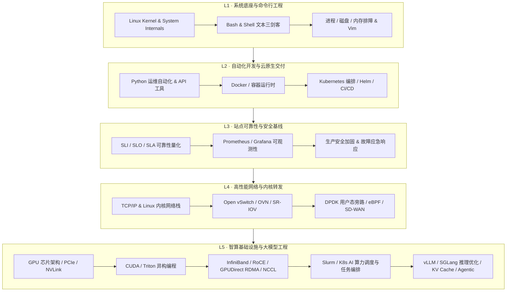

# 🚀 工程师运维小册（Engineer Operation Booklet）

<p align="center">
  <strong>面向现代基础设施工程师的工业级全栈知识库</strong><br>
  <sub>Linux 系统底座 · DevOps 与云原生 · SRE 站点可靠性 · 高性能内核网络 · HPC 超算调度 · GPU 异构编程 · AI 基础设施</sub>
</p>

<p align="center">
  <a href="README_en.md"><strong>English</strong></a> ·
  <a href="README.md"><strong>简体中文</strong></a>
</p>

<p align="center">
  
  
  
  
  
  
  
  
  
  
  
</p>

---

## 📑 目录导航（Table of Contents）
- [💡 项目定位与核心愿景](#-项目定位与核心愿景)
- [🧭 基础设施工程师全栈演进图谱（L1 ~ L5）](#-基础设施工程师全栈演进图谱l1--l5)
- [🗺️ 知识库全景导航与核心资产索引](#️-知识库全景导航与核心资产索引)
  - [1. Linux 系统管理与运维速查](#1-linux-系统管理与运维速查)
  - [2. 自动化运维与 Python 运维开发](#2-自动化运维与-python-运维开发)
  - [3. 数据库运维与存储高可用](#3-数据库运维与存储高可用)
  - [4. Web 服务架构与高性能网关](#4-web-服务架构与高性能网关)
  - [5. 高性能网络、SDN 与内核协议栈](#5-高性能网络sdn-与内核协议栈)
  - [6. DevOps 与云原生经典图书库（90+ 本）](#6-devops-与云原生经典图书库90-本)
  - [7. HPC 超算集群与作业调度自动化](#7-hpc-超算集群与作业调度自动化)
  - [8. GPU 异构编程与 CUDA 并行计算](#8-gpu-异构编程与-cuda-并行计算)
  - [9. AI 基础设施实战全栈（AI Fundamentals）](#9-ai-基础设施实战全栈ai-fundamentals)
  - [10. 生成式 AI 与大模型工程知识库](#10-生成式-ai-与大模型工程知识库)
  - [11. 工程师精选书单与开源生态导航](#11-工程师精选书单与开源生态导航)
- [🛡️ 生产工程底线与安全防背锅守则](#️-生产工程底线与安全防背锅守则)
  - [四大生产工程原则](#四大生产工程原则)
  - [生产高危操作十大红线 Checklist](#生产高危操作十大红线-checklist)
  - [经典事故复盘：GitLab 删库 6 小时事件警示](#经典事故复盘gitlab-删库-6-小时事件警示)
- [⚡ 生产排障三板斧与应急响应通道](#-生产排障三板斧与应急响应通道)
- [📁 真实仓库目录全景](#-真实仓库目录全景)
- [🤝 参与贡献与社区交流](#-参与贡献与社区交流)
- [⭐ 鸣谢与项目理念](#-鸣谢与项目理念)

---

## 💡 项目定位与核心愿景

**Engineer Operation Booklet（工程师运维小册）** 是一个由一线基础设施工程师共同维护与持续打磨的工业级知识底座。

互联网基础设施与算力架构正在经历深刻范式演进：

```
传统物理机/机房运维
       │
       ▼
DevOps 敏捷交付与自动化
       │
       ▼
SRE 站点可靠性与可观测性工程
       │
       ▼
Cloud Native 云原生与平台工程（Platform Engineering）
       │
       ▼
HPC 超算调度与 AI Infrastructure 智算平台工程
```

许多技术文档常常割裂于：**“单纯罗列某个命令怎么打”**，却缺少 **“为什么这样设计”、“内核与网络底层如何流转”、“生产环境如何避免高危踩坑”、“系统 Hang 死或崩溃时如何 5 分钟定位与自愈”**。

本项目旨在打造：**每一位工程师真正能随身查阅、指导实操生产、抵御灾难故障的 Infrastructure Engineering Handbook**。

> 🚩 **项目核心准则**：
> **看懂底层机制，写对自动化脚本，跑稳生产集群，防范操作风险——不掉坑、不背锅、不浪费算力！**

---

## 🧭 基础设施工程师全栈演进图谱（L1 ~ L5）

无论你是从事传统运维转型、平台工程、云原生还是 AI Infra，你都能在小册中找到对应阶梯的核心硬实力储备：



---

## 🗺️ 知识库全景导航与核心资产索引

本仓库不仅包含体系化的理论解析，更汇集了数万行生产验证脚本、权威书籍与专题手册。以下为仓库各模块直达导航：

### 1. Linux 系统管理与运维速查

| 核心文件 / 资源 | 核心内容与生产价值 |
|---|---|
| 📄 [**Bash手册.md**](Bash手册.md) | **4,100+ 行实操指南**：覆盖文件目录操作、权限配置、文本处理（`grep`/`sed`/`awk`/`sort`/`uniq`）、进程调度、磁盘排查、网络监测与高频脚本实操模板。 |
| 📄 [**Vim.md**](Vim.md) | 终端工程师必备：光标极速跳转、多窗口编辑、宏录制、全局替换正则与生产环境 `.vimrc` 调优。 |
| 📄 [**开源镜像.md**](开源镜像.md) | 国内主流 Linux 发行版（Ubuntu、CentOS、Rocky、Debian）及软件仓库（Docker、Pip、Npm）镜像源快速切换配置。 |

---

### 2. 自动化运维与 Python 运维开发

| 核心文件 / 资源 | 核心内容与生产价值 |
|---|---|
| 📄 [**Python实例手册_增强完善版.md**](Python实例手册_增强完善版.md) | **330KB+ 实战手册**：系统管理、自动化批处理、网络通信、文件解析、日志分析、进程管理及常用运维 API 对接实例。 |
| 🐍 [**Python_Learning.py**](Python_Learning.py) | **300KB+ 代码级实战宝库**：从基础语法到高级数据结构、多线程并发、网络套接字以及面向对象编程规范。 |
| 📄 [**python学习.md**](python学习.md) | Python 进阶核心知识点提炼：装饰器、生成器、协程并发、异常链路与性能分析。 |

---

### 3. 数据库运维与存储高可用

| 核心文件 / 资源 | 核心内容与生产价值 |
|---|---|
| 📄 [**MYSQL手册.md**](MYSQL手册.md) | 涵盖 MySQL 生产安装部署、账户安全与细粒度权限控制、主从半同步/异步复制搭建、`mysqldump`/XtraBackup 冷热备份策略、高危 SQL 拦截与慢查询优化。 |

---

### 4. Web 服务架构与高性能网关

| 核心文件 / 资源 | 核心内容与生产价值 |
|---|---|
| 📄 [**Devops_web.md**](Devops_web.md) | **250KB+ 超大技术全景**：企业级 Web 架构设计、Nginx 核心配置与内核调优、高并发反向代理、负载均衡算法、SSL/TLS 证书加固、免费即服务（Free-for-dev）云资源生态全景图。 |

---

### 5. 高性能网络、SDN 与内核协议栈

> 完整实战书籍：[**sdn-handbook**](sdn-handbook/README.md)（软件定义网络深度实战手册）

| 分篇专题 | 涵盖核心技术 | 直达链接 |
|---|---|---|
| 🌐 **网络基础篇** | TCP/IP 模型、ARP、ICMP、路由、交换、VLAN、Overlay (VxLAN/GRE)、SNMP、LLDP | [basic/README.md](sdn-handbook/basic/README.md) |
| 🐧 **Linux 网络篇** | Linux 网络配置、虚拟设备（veth/bridge/tun/tap）、iptables/netfilter、SR-IOV、VRF、eBPF/XDP | [linux/README.md](sdn-handbook/linux/README.md) |
| 🔀 **Open vSwitch** | OVS 架构、流表操作（OpenFlow）、OVN 控制器、网络虚拟化集成 | [ovs/](sdn-handbook/ovs/) |
| ⚡ **DPDK 高性能转发** | 用户态协议栈、UIO/VFIO、Hugepages 大页内存、零拷贝环形队列（Ring）、性能基准 | [dpdk/](sdn-handbook/dpdk/) |
| 🛡️ **网络安全与设备** | IPSec VPN、Firewall 状态防火墙、流量控制（TC / QoS） | [secure/](sdn-handbook/secure/) |
| 🚀 **SDN & NFV & SD-WAN**| 控制平面与数据平面解耦、OpenFlow、NETCONF/YANG、SD-WAN 架构方案 | [sdn/](sdn-handbook/sdn/) |
| 🧪 **实战工程演练** | Mininet 仿真网络构建、OpenStack Neutron 网络实践、Google 数据中心网络架构剖析 | [practice/](sdn-handbook/practice/) |

---

### 6. DevOps 与云原生经典图书库（90+ 本）

> 资源聚合目录：[**DevOps_Books**](DevOps_Books/README.md) —— 93 本精选工业级 PDF 原版教材

- **容器与微服务**：*Docker Deep Dive*、*Docker in Practice*、*O'Reilly Kubernetes Patterns*、*The Kubernetes Book*、*OpenShift in Action*
- **自动化配置管理**：*Ansible Up and Running*、*Ansible Best Practices*、*Terraform: Up & Running*、*IaC Playbook*
- **SRE 与云架构**：*Site Reliability Engineering (Google)*、*Cloud Native DevOps with Kubernetes*、*AWS/Azure Solutions Architect Guides*
- **CI/CD 交付流水线**：*Jenkins From Scratch*、*TheNewStack CI/CD*、*API-driven DevOps*

---

### 7. HPC 超算集群与作业调度自动化

| 核心工具与脚本 | 生产级特性与调度场景 |
|---|---|
| ⚙️ [**sbatch-slurm.pl**](sbatch-slurm.pl) | **330KB+、4,800+ 行单文件零外部依赖的生产级 Slurm 作业脚手架**：支持双语注释、批量解析作业命令列表、自动生成 sbatch 脚本、squeue/sacct 智能状态机轮询、故障作业智能重试与详尽执行审计报告。 |
| ⚙️ [**qsub-sge.pl**](qsub-sge.pl) | SGE（Sun Grid Engine）经典超算网格调度运行工具，适配海量批处理作业提交与依赖管理。 |

---

### 8. GPU 异构编程与 CUDA 并行计算

> 专题学习合集：[**CUDA-Learning**](CUDA-Learning/README.md) —— 权威教材、课程源码与渐进优化实战

- 📖 **经典教材集成**：《CUDA C 编程权威指南》、《CUDA 编程：基础与实践》、《GPU 高性能编程 CUDA 实战》、《CUDA 专家手册》等 8 部权威书籍。
- 🎥 **名师视频配套源码**：罗韵老师 12 课完整源码（直方图、RGB转灰度、矩阵转置、CUDA-Aware MPI、KNN、LK 光流跟踪）与周斌教授 CUDA 课程讲义。
- ⚡ **并行优化实战**：包含 7 种算法由浅入深的[并行归约渐进式优化](CUDA-Learning/利用并行归约进行数字求和/)示例。
- 🔬 [**NVIDIA GPUDirect RDMA 与 GDS 技术详解.md**](NVIDIA_GPUDirect_RDMA_GDS_技术详解.md)（配套 [可视化排版](NVIDIA_GPUDirect_RDMA_GDS_技术详解_排版_摸鱼绿(moyu-green).html)）：**1,700 行深度技术白皮书**，剖析第三方 PCIe/NVMe 设备、NIC/DPU 与 GPU 显存直通机制，详解 cuFile API、P2PDMA、DMA-BUF 与高性能存储总线拓扑。

---

### 9. AI 基础设施实战全栈（AI Fundamentals）

> 实战小册主入口：[**AI-fundamentals**](AI-fundamentals/README.md)
> 口号：**看懂硬件，写对算子，跑稳集群，算清成本——不掉坑，不白花算力！**

| 专题模块 | 重点覆盖技术 | 目录入口 |
|---|---|---|
| **01 硬件架构与互连** | GPU/NPU 微架构、Tensor Core、HBM3e、PCIe Gen5、NVLink 4/5、NVSwitch、GPUDirect、GB200/GB300 系统 | [01_hardware_architecture](AI-fundamentals/01_hardware_architecture/README.md) |
| **02 异构计算编程** | CUDA 核心编程、TileLang 高性能算子、DOCA（DPU 开发）、昇腾 CANN 算子迁移与适配 | [02_gpu_programming](AI-fundamentals/02_gpu_programming/README.md) |
| **03 AI 集群运维** | `nvidia-smi` 深度诊断、GPU 假死排查、InfiniBand 拓扑、RoCE 无损网络、NCCL 性能调优、ibstat/ibv 压测 | [03_ai_cluster_ops](AI-fundamentals/03_ai_cluster_ops/README.md) |
| **04 云原生 AI 平台** | Kubernetes GPU 共享与拓扑感知调度、Kueue 弹性排队、vGPU / HAMi 算力切分、JuiceFS/3FS 高性能缓存 | [04_cloud_native_ai_platform](AI-fundamentals/04_cloud_native_ai_platform/README.md) |
| **05 模型训练与微调** | 预训练技术、SFT 监督微调、LoRA / QLoRA 轻量化训练、DeepSpeed / Megatron-LM 分布式并行切分 | [05_model_training_and_fine_tuning](AI-fundamentals/05_model_training_and_fine_tuning/README.md) |
| **06 LLM 理论与基础** | Transformer 算子推导、FlashAttention 原理、MoE 稀疏门控、GPTQ/AWQ 模型量化、Deep Research 体系 | [06_llm_theory_and_fundamentals](AI-fundamentals/06_llm_theory_and_fundamentals/README.md) |
| **07 RAG 与工具生态** | 向量数据库选型、分块策略、GraphRAG 知识图谱融合、多路召回重排、PDF 工业级复杂解析 | [07_rag_and_tools](AI-fundamentals/07_rag_and_tools/README.md) |
| **08 企业级 Agent 系统**| 多智能体协作（Multi-Agent）、MCP（Model Context Protocol）、上下文状态管理、长短记忆工程 | [08_agentic_system](AI-fundamentals/08_agentic_system/README.md) |
| **09 推理系统与优化** | vLLM / SGLang 架构剖析、PagedAttention 机制、Continuous Batching、KV Cache 压缩演进与显存/算力成本精算 | [09_inference_system](AI-fundamentals/09_inference_system/README.md) |
| **10~11 AI 原生全栈** | AI System 全套课程体系、Trae/Cursor 提效、Vibe Coding 理念、Software 3.0 工程范式重塑 | [11_ai_native_everything](AI-fundamentals/11_ai_native_everything/README.md) |

---

### 10. 生成式 AI 与大模型工程知识库

| 核心文件 / 资源 | 核心内容与生产价值 |
|---|---|
| 📚 [**Generative_AI _Handbook**](Generative_AI%20_Handbook/README.md) | 中英双语大模型进阶学习路线图，整合 *Hands-On Large Language Models*、*Practical MLOps*、*Designing Machine Learning Systems* 等 9 本重磅 PDF 著作。 |
| 💻 [**500-AI-Projects-with-code.md**](500-AI-Machine-learning-Deep-learning-Computer-vision-NLP-Projects-with-code.md) | 涵盖机器学习、深度学习、计算机视觉、NLP、LLM 领域的 500 个带源码实战开源项目汇总。 |

---

### 11. 工程师精选书单与开源生态导航

| 核心文件 / 资源 | 核心内容与生产价值 |
|---|---|
| 📚 [**awesome-book.md**](awesome-book.md) | 200KB+ 经典计算机科学、系统设计、高并发架构、数据库内核书单。 |
| 🛠️ [**awesomeDevops.md**](awesomeDevops.md) | 全面梳理 Sysadmin 与 DevOps 顶级开源工具链（监控、备份、CI/CD、虚拟化、配置审计）。 |
| 🔍 [**Google.md**](Google.md) | 120KB+ Google 工程师文化、技术视野与高阶检索指南。 |

---

## 🛡️ 生产工程底线与安全防背锅守则

### 四大生产工程原则

1. **Automation First（自动化优先）**：杜绝一切不可审计、无法复现的人工“临时登录机器敲命令”。所有常规变更必须代码化（IaC）、流程化、脚本化。
2. **Security by Default（默认安全）**：最小权限原则（PoLP）、生产与办公网络物理/逻辑隔离、默认拒绝所有非必要入站端口、凭证禁止明文入库。
3. **Everything Observable（万物即可观测）**：没有监控报警的系统等同于“黑盒”。系统必须具备回答三个问题的能力：*正在发生什么？为什么发生？恢复动作是什么？*
4. **Failure Is Normal（拥抱故障与快速自愈）**：墨菲定律始终生效。优秀的工程师追求的是**缩短平均发现时间（MTTD）**与**缩短平均修复时间（MTTR）**，而非幻想故障永远不发生。

---

### 生产高危操作十大红线 Checklist

> 💡 **运维口号：严格遵守生产规范，不掉坑，不背锅！**

- [ ] **红线 1：严禁直接执行无明确目录限制的通配删除**：如 `rm -rf /` 或变量未判空的 `rm -rf $DIR/*`（当 `$DIR` 为空时直接变成根目录删除）。
- [ ] **红线 2：严禁未备份直接变更核心数据与配置**：修改 `/etc/fstab`、网卡配置、数据库表结构前，必须先备份原文件（如 `cp -a /etc/hosts{,.bak_$(date +%F)}`）。
- [ ] **红线 3：严禁非只读模式直接在生产库执行 `UPDATE / DELETE`**：必须先在从库或测试库演练，且主库执行必须带 `WHERE` 条件与 `LIMIT`，严禁关闭安全更新模式。
- [ ] **红线 4：严禁在跳板机/集群节点跨主机直接执行包含明文密码的命令**：如 `mysql -uroot -p123456` 会被 `ps -ef` 和历史记录完全捕获，使用配置段或环境变量隔离。
- [ ] **红线 5：严禁高峰期直接做网络重载、防火墙刷新与存储卸载**：如 `iptables -F`（无默认 ACCEPT 规则下直接断网失联）、`systemctl restart networking`。
- [ ] **红线 6：严禁生产系统部署无安全认证的公开组件**：如将 Redis 绑定 `0.0.0.0` 且无密码、Elasticsearch 暴露公网端口直接导致挖矿木马秒级入侵。
- [ ] **红线 7：严禁多终端操作时搞错 Session 上下文**：同时开启开发、测试、生产多个 SSH 终端时，窗口标题与终端配色必须明确隔离（红底代表高危生产）。
- [ ] **红线 8：严禁集群环境执行大批量未经限流的突发任务**：如未限制并行度的批量分发、瞬间拉爆交换机背板或底层存储 IOPS。
- [ ] **红线 9：严禁变更前不制定 Rollback（回滚）预案**：任何变更方案必须包括明确的预期成功指标、超时熔断点与一键回退动作。
- [ ] **红线 10：严禁使用 `chmod -R 777` 解决权限报错**：权限报错必有其所属组与用户上下文，777 是极其不负责任的安全漏洞根源。

---

### 经典事故复盘：GitLab 删库 6 小时事件警示

> **事件回顾**：2017 年 1 月 31 日，GitLab 发生重大生产事故。运维工程师在处理数据库复制延迟问题时，因连续高强度疲劳工作，误将生产主库（Production）误认为从库（Staging），敲下了 `rm -rf`，导致 300GB 生产数据被彻底抹除。更严重的是，团队发现配置的 5 种自动化备份方案均存在失效或未跑通的问题，最终耗费数十小时才从异地快照中恢复，造成严重商业损失与声誉影响。

**我们从中应当汲取的血泪教训**：
1. **未经验证的备份不叫备份**：必须定期开展自动化还原演练（RPO / RTO 考核），未成功还原过的备份文件只是一堆无用字节。
2. **多重安全护栏（Guardrails）**：核心数据库服务器必须在命令行提示符（PS1）、系统 Banner、别名别置（将 `rm` 别名为安全移至回收站或带安全确认）建立视觉与物理拦截。
3. **疲劳轮岗与双人复核（Peer Review）**：重大高危变更（删库、降级、网络切流）严禁一人在深夜疲劳状态下单点决策执行，必须遵循四眼原则（Two-Person Rule）。

---

## ⚡ 生产排障三板斧与应急响应通道

当生产系统出现异常时，切忌盲目重启，推荐采用 **USE / RED 方法论** 快速锁定瓶颈：

```
                    ┌─────────────────────────┐
                    │     系统产生告警 / 故障   │
                    └────────────┬────────────┘
                                 │
                 ┌───────────────┴───────────────┐
                 ▼                               ▼
       【系统与基础设施层 USE】          【应用服务与调度层 RED】
       - Utilization（资源使用率）        - Rate（请求/吞吐速率）
       - Saturation（饱和度/排队）       - Errors（错误数与异常状态码）
       - Errors（硬件与内核错误）        - Duration（响应延迟/时延分布）
                 │                               │
                 └───────────────┬───────────────┘
                                 ▼
                     ┌───────────────────────┐
                     │ 止血隔离 -> 根因分析 -> 复盘 │
                     └───────────────────────┘
```

### 1. 基础系统与网络快速排障命令

```bash
# 1. 查看系统整体负载与 CPU 饱和度
uptime && vmstat 1 5

# 2. 查看内存与 Swap 换入换出状态
free -h && vmstat -s

# 3. 磁盘 I/O 队列与等待率（重点关注 %util 与 await）
iostat -xz 1 5

# 4. 网络连接状态统计与监听端口排查
ss -s && ss -tulpn

# 5. 系统内核 Ring Buffer 报错与 OOM 击杀排查
dmesg -T | grep -iE 'oom|error|killed|segfault'
```

### 2. GPU 智算集群专用排障命令

```bash
# 1. 快速检查 GPU 拓扑连接与 NVLink 状态
nvidia-smi topo -m

# 2. 排查 GPU 进程死锁或掉卡（ERR! / Unknown Error）
nvidia-smi --query-gpu=index,gpu_bus_id,pstate,temperature.gpu,utilization.gpu,memory.used,memory.total --format=csv

# 3. 检查 InfiniBand 网卡物理链路与速率
ibstat && ibv_devinfo -v

# 4. 实时跟踪 NCCL 通信与排查 Hang（设置调试环境变量）
export NCCL_DEBUG=INFO
export NCCL_DEBUG_SUBSYS=ALL
```

---

## 📁 真实仓库目录全景

```
d:\DevopsBooklet
│
├── 📂 AI-fundamentals/            # 🤖 AI 基础设施实战全栈（12 大模块：硬件底座/GPU编程/集群运维/K8s/微调/推理/Agent）
├── 📂 CUDA-Learning/              # ⚡ GPU 异构并行编程宝库（8 本经典著作、罗韵/周斌视频全套代码、并行归约优化）
├── 📂 DevOps_Books/               # 📚 经典工程图书库（93 本原版 PDF：K8s、Docker、Ansible、Terraform、SRE、AWS）
├── 📂 Generative_AI _Handbook/    # 🧠 生成式 AI 进阶路线与 9 本大模型架构、MLOps 权威教材
├── 📂 sdn-handbook/               # 🌐 软件定义网络实战全书（TCP/IP、Linux 内核网络、OVS、DPDK、NFV、SD-WAN）
├── 📂 images/                     # 🖼️ 架构原理图与配套工程演示动画
│
├── 📄 Bash手册.md                  # 🐧 4,100+ 行 Linux 系统与 Bash 实操排障大百科
├── 📄 MYSQL手册.md                 # 🐬 MySQL 生产部署、权限审计、主从复制、冷热备份与规避指南
├── 📄 Devops_web.md               # 🌍 250KB+ Web 体系、Nginx 调优与 Free-for-Dev 云资源清单
├── 📄 Python实例手册_增强完善版.md  # 🐍 330KB+ Python 系统管理、自动化批处理与工具开发手册
├── 🐍 Python_Learning.py          # 💻 300KB+ Python 全功能实战代码库（语法、并发、网络通信、OOP）
├── 📄 python学习.md               # 📝 Python 进阶核心机制与知识点整理
├── 📄 Vim.md                      # ⌨️ 生产环境 Vim 快捷键与提效调优
├── 📄 NVIDIA_GPUDirect_RDMA_GDS_技术详解.md  # 🔬 1,700 行深度拆解 GPUDirect RDMA / GDS / cuFile 软硬件底座
├── ⚙️ sbatch-slurm.pl              # 🚀 330KB+、4,800 行 Slurm 超算集群作业自动化提交与智能监控状态机
├── ⚙️ qsub-sge.pl                  # ⚙️ SGE 经典超算网格作业自动化调度工具
├── 📄 awesome-book.md             # 📖 经典计算机科学与高可用系统设计书单
├── 📄 awesomeDevops.md            # 🧰 SysAdmin 与 DevOps 顶级开源工具链全收录
├── 📄 Google.md                   # 🔎 Google 工程师文化与高阶搜索经验
├── 📄 开源镜像.md                  # 🇨🇳 国内 Linux 发行版与包管理器加速镜像配置
└── 📄 500-AI-Machine-learning-...-Projects-with-code.md # 🧪 500 个带源码的 AI 开源实战项目汇总
```

---

## 🤝 参与贡献与社区交流

我们热忱欢迎所有对 **DevOps / SRE / Cloud Native / SDN / HPC / AI Infra** 感兴趣的同行参与共建！

### 贡献方向
- 📝 提交生产环境验证过的真实 Runbook 与故障应急预案
- 🐛 纠正文档与脚本中的陈旧命令或配置错误
- 💡 补充新一代技术实践（如 vLLM/SGLang 性能调优、K8s 调度拓展、eBPF 监控方案）
- 🌐 完善中英双语国际化翻译

### 贡献流程
1. Fork 本仓库并新建分支（`git checkout -b feature/awesome-handbook`）
2. 提交代码与文档（保持清晰规范的 commit message）
3. 创建 Pull Request，详细描述变更内容与生产背景

### 社区交流
- **QQ 交流群**：`313682642`
- **联系邮箱**：`golucklee@gmail.com`
- **微信技术交流**：请扫描下方二维码添加交流，共同交流探讨基础设施前沿技术。

<p align="center">
  
</p>

---

## ⭐ 鸣谢与项目理念

> **Build Reliable Infrastructure.**
> **Automate Everything.**
> **Learn From Failure.**
> **Engineer The Future.**

建设可靠基础设施，自动化一切重复工作，从故障中持续成长，面向未来工程实践。

感谢所有为开源世界贡献 DevOps、SRE、云计算、网络协议栈与 AI Infrastructure 智慧的工程师！如果本项目对你的日常工作有所帮助，欢迎点亮右上角的 **⭐ Star** 支持我们！
