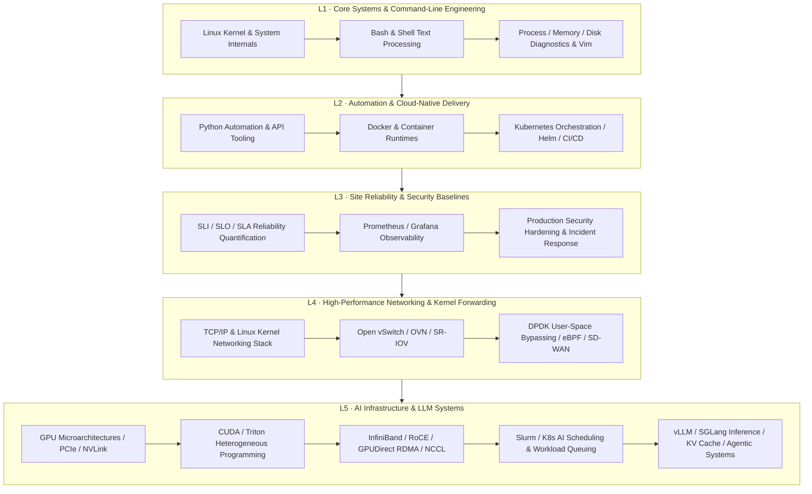

# 🚀 Engineer Operation Booklet

<p align="center">
  <strong>Industrial-Grade Full-Stack Knowledge Base for Modern Infrastructure Engineers</strong><br>
  <sub>Linux Systems · DevOps & Cloud Native · SRE & Reliability · Kernel Networking & SDN · HPC Scheduling · GPU Computing · AI Infrastructure</sub>
</p>

<p align="center">
  <a href="README_en.md"><strong>English</strong></a> ·
  <a href="README.md"><strong>简体中文</strong></a>
</p>

<p align="center">
  
  
  
  
  
  
  
  
  
  
  
</p>

---

## 📑 Table of Contents
- [💡 Project Mission & Vision](#-project-mission--vision)
- [🧭 Infrastructure Engineer Career Evolution Roadmap (L1 ~ L5)](#-infrastructure-engineer-career-evolution-roadmap-l1--l5)
- [🗺️ Repository Navigation & Asset Index](#️-repository-navigation--asset-index)
  - [1. Linux System Administration & Ops Cheat Sheet](#1-linux-system-administration--ops-cheat-sheet)
  - [2. Automation & Python Ops Development](#2-automation--python-ops-development)
  - [3. Database Administration & High-Availability Storage](#3-database-administration--high-availability-storage)
  - [4. Web Architecture & High-Performance Gateways](#4-web-architecture--high-performance-gateways)
  - [5. High-Performance Networking, SDN & Kernel Protocol Stacks](#5-high-performance-networking-sdn--kernel-protocol-stacks)
  - [6. DevOps & Cloud Native Classic Library (90+ Books)](#6-devops--cloud-native-classic-library-90-books)
  - [7. HPC Supercomputing Clusters & Automated Workload Scheduling](#7-hpc-supercomputing-clusters--automated-workload-scheduling)
  - [8. GPU Heterogeneous Computing & CUDA Parallel Programming](#8-gpu-heterogeneous-computing--cuda-parallel-programming)
  - [9. Full-Stack AI Infrastructure Engineering (AI Fundamentals)](#9-full-stack-ai-infrastructure-engineering-ai-fundamentals)
  - [10. Generative AI & Large Language Model Knowledge Base](#10-generative-ai--large-language-model-knowledge-base)
  - [11. Curated Engineering Books & Open-Source Ecosystem](#11-curated-engineering-books--open-source-ecosystem)
- [🛡️ Production Engineering Principles & Safety Guardrails](#️-production-engineering-principles--safety-guardrails)
  - [Four Core Production Principles](#four-core-production-principles)
  - [Top 10 High-Risk Production Traps Checklist](#top-10-high-risk-production-traps-checklist)
  - [Postmortem Case Study: Lessons from the GitLab 6-Hour Data Loss Incident](#postmortem-case-study-lessons-from-the-gitlab-6-hour-data-loss-incident)
- [⚡ Production Incident Response & Troubleshooting Playbook](#-production-incident-response--troubleshooting-playbook)
- [📁 Exact Repository Structure](#-exact-repository-structure)
- [🤝 Contributing & Community](#-contributing--community)
- [⭐ Acknowledgments & Core Philosophy](#-acknowledgments--core-philosophy)

---

## 💡 Project Mission & Vision

**Engineer Operation Booklet** is an industrial-grade infrastructure knowledge base continuously developed and maintained by frontline production engineers.

Internet infrastructure and computing paradigms have been undergoing rapid transitions:

```
Bare-Metal / Datacenter SysAdmin
              │
              ▼
DevOps Agile Delivery & Automation
              │
              ▼
SRE Site Reliability & Observability Engineering
              │
              ▼
Cloud Native & Platform Engineering
              │
              ▼
HPC Supercomputing & AI Infrastructure Engineering
```

Many online technical documents are fragmented: they either **"list superficial commands without context"** or miss the critical engineering depths: **"Why was it designed this way?", "How do packets and data flow through kernel/hardware layers?", "How do you avoid lethal operational pitfalls in production?", and "When a cluster hangs or crashes, how do you locate the root cause within 5 minutes?"**.

This handbook is built to be: **The field manual that every engineer can keep at hand to guide real-world production, survive catastrophic outages, and master infrastructure architecture.**

> 🚩 **Core Slogan**:
> **Understand the underlying mechanisms, automate without failure, run clusters with high reliability, and guard against high-risk pitfalls—avoid mistakes, avoid taking the blame, and never waste compute power!**

---

## 🧭 Infrastructure Engineer Career Evolution Roadmap (L1 ~ L5)

Whether you are a Linux system administrator, a cloud-native platform engineer, an SRE, or an AI Infra specialist, this handbook maps out the key competencies required at every stage:



---

## 🗺️ Repository Navigation & Asset Index

This repository goes beyond theoretical concepts, hosting tens of thousands of lines of battle-tested scripts, authoritative handbooks, and specialized submodules. Below is the direct navigation index:

### 1. Linux System Administration & Ops Cheat Sheet

| Core File / Asset | Technical Depth & Production Value |
|---|---|
| 📄 [**Bash手册.md**](Bash手册.md) | **4,100+ lines of battle-tested operations**: Comprehensive guide covering file permissions, text stream processing (`grep`, `sed`, `awk`, `sort`, `uniq`), process lifecycle, disk troubleshooting, socket diagnostics, and automated inspection scripts. |
| 📄 [**Vim.md**](Vim.md) | Essential command-line editing mastery: cursor jumping, multi-window buffers, macro recording, regex search-and-replace, and production-optimized `.vimrc` configurations. |
| 📄 [**开源镜像.md**](开源镜像.md) | Fast mirror configurations for mainstream Linux distributions (Ubuntu, CentOS, Rocky, Debian) and package managers (Docker, Pip, Npm). |

---

### 2. Automation & Python Ops Development

| Core File / Asset | Technical Depth & Production Value |
|---|---|
| 📄 [**Python实例手册_增强完善版.md**](Python实例手册_增强完善版.md) | **330KB+ comprehensive manual**: System administration scripts, batch automation, network sockets, file parsing, log processing, subprocess orchestration, and enterprise DevOps API integrations. |
| 🐍 [**Python_Learning.py**](Python_Learning.py) | **300KB+ runnable code repository**: From core language fundamentals to advanced data structures, multi-threading concurrency, network programming, and object-oriented architectures. |
| 📄 [**python学习.md**](python学习.md) | Advanced Python internals: decorators, generators, async coroutines, traceback chains, and profiling. |

---

### 3. Database Administration & High-Availability Storage

| Core File / Asset | Technical Depth & Production Value |
|---|---|
| 📄 [**MYSQL手册.md**](MYSQL手册.md) | Production MySQL deployment, account security, least-privilege RBAC, semi-sync/async master-slave replication, `mysqldump`/XtraBackup cold/hot backup strategies, slow query diagnosis, and high-risk query mitigation. |

---

### 4. Web Architecture & High-Performance Gateways

| Core File / Asset | Technical Depth & Production Value |
|---|---|
| 📄 [**Devops_web.md**](Devops_web.md) | **250KB+ massive architecture catalog**: Production Nginx configuration and kernel socket tuning, high-concurrency reverse proxying, load balancing algorithms, SSL/TLS certificate security, and an exhaustive Free-for-Dev cloud resources ecosystem. |

---

### 5. High-Performance Networking, SDN & Kernel Protocol Stacks

> Complete Handbook: [**sdn-handbook**](sdn-handbook/README.md) (Software-Defined Networking Deep-Dive)

| Section | Core Technologies Covered | Link |
|---|---|---|
| 🌐 **Networking Basics** | TCP/IP model, ARP, ICMP, Routing, Switching, VLAN, Overlay (VxLAN/GRE), SNMP, LLDP | [basic/README.md](sdn-handbook/basic/README.md) |
| 🐧 **Linux Networking** | Linux net configuration, virtual devices (veth, bridge, tun/tap), iptables/netfilter, SR-IOV, VRF, eBPF/XDP | [linux/README.md](sdn-handbook/linux/README.md) |
| 🔀 **Open vSwitch** | OVS architecture, OpenFlow match-action pipelines, OVN logical routers/switches, virtualization integration | [ovs/](sdn-handbook/ovs/) |
| ⚡ **DPDK High-Speed Forwarding** | User-space packet processing, UIO/VFIO, Hugepages, zero-copy lockless ring buffers, forwarding benchmarks | [dpdk/](sdn-handbook/dpdk/) |
| 🛡️ **Network Security & Appliances** | IPSec VPN, stateful firewalls, traffic control (TC / QoS queueing) | [secure/](sdn-handbook/secure/) |
| 🚀 **SDN & NFV & SD-WAN** | Decoupled control and data planes, OpenFlow controllers, NETCONF/YANG, SD-WAN enterprise architectures | [sdn/](sdn-handbook/sdn/) |
| 🧪 **Hands-on Labs** | Mininet virtual network topologies, OpenStack Neutron networking, Google datacenter network teardowns | [practice/](sdn-handbook/practice/) |

---

### 6. DevOps & Cloud Native Classic Library (90+ Books)

> Curated Archive: [**DevOps_Books**](DevOps_Books/README.md) —— 93 industry-standard original PDF engineering books

- **Containers & Microservices**: *Docker Deep Dive*, *Docker in Practice*, *O'Reilly Kubernetes Patterns*, *The Kubernetes Book*, *OpenShift in Action*
- **Infrastructure as Code (IaC)**: *Ansible Up and Running*, *Ansible Best Practices*, *Terraform: Up & Running*, *IaC Playbook*
- **SRE & Cloud Architecture**: *Site Reliability Engineering (Google)*, *Cloud Native DevOps with Kubernetes*, *AWS/Azure Solutions Architect Study Guides*
- **Continuous Delivery**: *Jenkins From Scratch*, *TheNewStack CI/CD*, *API-driven DevOps*

---

### 7. HPC Supercomputing Clusters & Automated Workload Scheduling

| Core Tool / Script | Production Features & Scheduling Workloads |
|---|---|
| ⚙️ [**sbatch-slurm.pl**](sbatch-slurm.pl) | **330KB+, 4,800+ lines self-contained zero-dependency production Slurm job scaffold**: Supports bilingual code annotations, batch command parsing, automated sbatch file synthesis, intelligent `squeue`/`sacct` state-machine polling, error recovery retries, and comprehensive execution audit reports. |
| ⚙️ [**qsub-sge.pl**](qsub-sge.pl) | SGE (Sun Grid Engine) batch scheduler automation tool for legacy and enterprise grid computing environments. |

---

### 8. GPU Heterogeneous Computing & CUDA Parallel Programming

> Dedicated Learning Collection: [**CUDA-Learning**](CUDA-Learning/README.md) —— Authoritative textbooks, video course source code, and progressive optimization labs

- 📖 **Textbook Archive**: 8 authoritative books including *Professional CUDA C Programming*, *CUDA Programming: Fundamentals and Practice*, *CUDA by Example*, and *The CUDA Handbook*.
- 🎥 **Video Course Codebases**: 12 complete lessons by Luo Yun (Histograms, RGB-to-Grayscale, Matrix Transpose, CUDA-Aware MPI, KNN, Lucas-Kanade Optical Flow) and Professor Zhou Bin's lecture materials.
- ⚡ **Optimization Labs**: Step-by-step [Parallel Reduction Progressive Optimization](CUDA-Learning/利用并行归约进行数字求和/) exploring 7 progressive optimization algorithms.
- 🔬 [**NVIDIA GPUDirect RDMA & GDS Technical Whitepaper.md**](NVIDIA_GPUDirect_RDMA_GDS_技术详解.md) (with [HTML Presentation](NVIDIA_GPUDirect_RDMA_GDS_技术详解_排版_摸鱼绿(moyu-green).html)): **1,700-line comprehensive technical deep dive** into direct DMA/RDMA paths between PCIe devices/NICs/DPUs and GPU HBM, cuFile APIs, P2PDMA, DMA-BUF, and high-throughput storage topologies.

---

### 9. Full-Stack AI Infrastructure Engineering (AI Fundamentals)

> Flagship Submodule: [**AI-fundamentals**](AI-fundamentals/README.md)
> Slogan: **Understand the hardware, write the right kernels, keep clusters rock-solid, and optimize compute costs!**

| Module | Core Technical Focus | Entry Point |
|---|---|---|
| **01 Hardware Architecture** | GPU/NPU microarchitectures, Tensor Cores, HBM3e, PCIe Gen5, NVLink 4/5, NVSwitch, GPUDirect, GB200/GB300 systems | [01_hardware_architecture](AI-fundamentals/01_hardware_architecture/README.md) |
| **02 Heterogeneous Programming** | CUDA core programming, TileLang custom kernels, DOCA (DPU acceleration), Ascend CANN operator porting | [02_gpu_programming](AI-fundamentals/02_gpu_programming/README.md) |
| **03 AI Cluster Operations** | Advanced `nvidia-smi` diagnostics, GPU deadlock mitigation, InfiniBand topologies, RoCE lossless networks, NCCL tuning, ibstat/ibv benchmarking | [03_ai_cluster_ops](AI-fundamentals/03_ai_cluster_ops/README.md) |
| **04 Cloud-Native AI Platform** | Kubernetes GPU sharing and topology-aware scheduling, Kueue queuing, vGPU / HAMi slicing, JuiceFS/3FS distributed caching | [04_cloud_native_ai_platform](AI-fundamentals/04_cloud_native_ai_platform/README.md) |
| **05 Model Training & Tuning** | Pretraining pipelines, Supervised Fine-Tuning (SFT), LoRA / QLoRA lightweight adaptation, DeepSpeed / Megatron-LM distributed parallelism | [05_model_training_and_fine_tuning](AI-fundamentals/05_model_training_and_fine_tuning/README.md) |
| **06 LLM Theory & Fundamentals**| Transformer math derivations, FlashAttention mechanics, MoE sparse gating, GPTQ/AWQ model quantization, Deep Research systems | [06_llm_theory_and_fundamentals](AI-fundamentals/06_llm_theory_and_fundamentals/README.md) |
| **07 RAG & Tool Ecosystem** | Vector database selection, chunking strategies, GraphRAG knowledge graphs, hybrid retrieval & re-ranking, enterprise PDF parsing | [07_rag_and_tools](AI-fundamentals/07_rag_and_tools/README.md) |
| **08 Enterprise Agentic Systems**| Multi-Agent orchestration, MCP (Model Context Protocol), conversation state management, short/long-term memory architectures | [08_agentic_system](AI-fundamentals/08_agentic_system/README.md) |
| **09 Inference Systems & Optimization** | vLLM / SGLang internals, PagedAttention, Continuous Batching, KV Cache eviction and compression, compute/memory cost economics | [09_inference_system](AI-fundamentals/09_inference_system/README.md) |
| **10~11 AI-Native Everything** | Full AI System curriculum, Trae/Cursor workflows, Vibe Coding philosophy, Software 3.0 engineering paradigm shifts | [11_ai_native_everything](AI-fundamentals/11_ai_native_everything/README.md) |

---

### 10. Generative AI & Large Language Model Knowledge Base

| Core File / Asset | Technical Depth & Production Value |
|---|---|
| 📚 [**Generative_AI _Handbook**](Generative_AI%20_Handbook/README.md) | Bilingual modern AI learning roadmap curated with 9 authoritative PDF books including *Hands-On Large Language Models*, *Practical MLOps*, and *Designing Machine Learning Systems*. |
| 💻 [**500-AI-Projects-with-code.md**](500-AI-Machine-learning-Deep-learning-Computer-vision-NLP-Projects-with-code.md) | A curated collection of 500 hands-on AI projects with complete source code spanning Machine Learning, Deep Learning, Computer Vision, NLP, and LLMs. |

---

### 11. Curated Engineering Books & Open-Source Ecosystem

| Core File / Asset | Technical Depth & Production Value |
|---|---|
| 📚 [**awesome-book.md**](awesome-book.md) | 200KB+ reading list covering classic Computer Science, High-Concurrency System Design, and Database Internals. |
| 🛠️ [**awesomeDevops.md**](awesomeDevops.md) | Extensive curated catalog of open-source tools for Sysadmins and DevOps engineers (Monitoring, Backups, CI/CD, Virtualization, Security). |
| 🔍 [**Google.md**](Google.md) | 120KB+ deep-dive into Google's engineering culture, technical philosophies, and advanced search methodology. |

---

## 🛡️ Production Engineering Principles & Safety Guardrails

### Four Core Production Principles

1. **Automation First**: Eliminate unrecorded, non-reproducible manual interventions. All production changes must be code-defined (IaC), versioned, auditable, and automated.
2. **Security by Default**: Enforce the Principle of Least Privilege (PoLP), strict network segmentation, default-deny ingress firewalls, and zero-plaintext secret storage.
3. **Everything Observable**: An unmonitored system is a black box. Infrastructure must answer three questions in real-time: *What is happening? Why did it happen? How do we recover?*
4. **Failure Is Normal**: Murphy's Law is immutable. Great engineering focuses on minimizing **Mean Time to Detect (MTTD)** and **Mean Time to Recover (MTTR)** through resilient design and self-healing.

---

### Top 10 High-Risk Production Traps Checklist

> 💡 **Ops Motto: Strictly adhere to production standards to avoid pitfalls and avoid blame!**

- [ ] **Trap 1: Executing unconstrained wildcard deletions**: e.g., `rm -rf /` or unvalidated variable paths like `rm -rf $DIR/*` (which deletes the root partition if `$DIR` is empty or undefined).
- [ ] **Trap 2: Making core changes without immediate backups**: Modifying `/etc/fstab`, NIC configurations, or DB schemas without creating an exact timestamped copy first (e.g., `cp -a /etc/hosts{,.bak_$(date +%F)}`).
- [ ] **Trap 3: Running unconstrained `UPDATE / DELETE` queries on production databases**: Always dry-run queries on a staging/read-replica replica first, enforce explicit `WHERE` clauses with `LIMIT`, and never disable safe-updates mode.
- [ ] **Trap 4: Passing plaintext passwords in interactive shell commands**: e.g., `mysql -uroot -p123456` leaks directly into `ps -ef` tables, audit logs, and `.bash_history`. Always use encrypted credential stores or secure environment variables.
- [ ] **Trap 5: Flushing firewalls or reloading network interfaces during peak traffic**: e.g., running `iptables -F` when the default policy is `DROP` immediately isolates the host from SSH access.
- [ ] **Trap 6: Exposing administrative ports without authentication**: Binding Redis to `0.0.0.0` with no password or exposing unauthenticated Elasticsearch endpoints leads to immediate crypto-miner compromise.
- [ ] **Trap 7: Confusing terminal session contexts**: When managing development, staging, and production terminals simultaneously, always color-code host prompts (e.g., bright red background for production).
- [ ] **Trap 8: Launching unthrottled concurrent tasks across cluster nodes**: Unbounded parallel jobs can exhaust switch backplane throughput, saturate storage IOPS, and trigger catastrophic cascading failure.
- [ ] **Trap 9: Executing changes without a verified rollback plan**: Every change plan must define concrete success metrics, execution timeout thresholds, and a tested one-click rollback script.
- [ ] **Trap 10: Using `chmod -R 777` as a quick fix for permission errors**: Permission errors require proper user and group ownership mapping; `777` creates massive security vulnerabilities.

---

### Postmortem Case Study: Lessons from the GitLab 6-Hour Data Loss Incident

> **Incident Recap**: On January 31, 2017, GitLab suffered a catastrophic production outage. While troubleshooting replication lag under high fatigue, an engineer accidentally executed `rm -rf` on the production primary database instead of the staging node, wiping approximately 300GB of live data. To make matters worse, 5 different backup mechanisms were found to be either failing silently, misconfigured, or unexercised. Recovery required dozens of hours, causing major business interruption and reputation damage.

**Key Engineering Lessons**:
1. **An unverified backup is no backup at all**: Routine automated restore drills (RPO / RTO validation) are mandatory; backup files that have never been restored successfully are nothing more than useless bytes.
2. **Visual & Physical Guardrails**: Critical database nodes must feature distinct visual indicators in the shell prompt (`PS1`), system banners, and command aliases (aliasing `rm` to safe-trash with confirmation dialogs).
3. **Fatigue Mitigation & Two-Person Rule**: High-stakes destructive operations must never be executed by an exhausted single engineer late at night; mandatory peer review (the Four-Eyes Principle) must be enforced.

---

## ⚡ Production Incident Response & Troubleshooting Playbook

When an anomaly occurs in production, avoid reckless restarts. Apply the **USE / RED Methodologies** to pinpoint bottlenecks methodically:

```
                    ┌─────────────────────────┐
                    │  System Alert / Outage  │
                    └────────────┬────────────┘
                                 │
                 ┌───────────────┴───────────────┐
                 ▼                               ▼
     【Infrastructure Layer: USE】        【Service & App Layer: RED】
     - Utilization (% capacity used)      - Rate (requests/throughput)
     - Saturation (queue depth/wait)      - Errors (error count & codes)
     - Errors (device & kernel drops)     - Duration (latency distribution)
                 │                               │
                 └───────────────┬───────────────┘
                                 ▼
                     ┌───────────────────────┐
                     │ Contain -> RCA -> Fix │
                     └───────────────────────┘
```

### 1. Core Linux System & Network Diagnostic Commands

```bash
# 1. System load average and CPU run queue saturation
uptime && vmstat 1 5

# 2. Memory utilization and swap paging rates
free -h && vmstat -s

# 3. Disk I/O saturation and queue latency (inspect %util and await)
iostat -xz 1 5

# 4. Socket statistics and active listening ports
ss -s && ss -tulpn

# 5. Kernel ring buffer errors and OOM killer events
dmesg -T | grep -iE 'oom|error|killed|segfault'
```

### 2. GPU & AI Cluster Diagnostic Commands

```bash
# 1. Inspect GPU physical topology and NVLink interconnects
nvidia-smi topo -m

# 2. Check for deadlocked GPU processes or hardware faults (ERR! / Unknown Error)
nvidia-smi --query-gpu=index,gpu_bus_id,pstate,temperature.gpu,utilization.gpu,memory.used,memory.total --format=csv

# 3. Verify InfiniBand HCA physical link status and port rates
ibstat && ibv_devinfo -v

# 4. Real-time NCCL communication tracing for distributed hang debugging
export NCCL_DEBUG=INFO
export NCCL_DEBUG_SUBSYS=ALL
```

---

## 📁 Exact Repository Structure

```
d:\DevopsBooklet
│
├── 📂 AI-fundamentals/            # 🤖 Full-Stack AI Infrastructure (Hardware / GPU / Ops / K8s / Fine-Tuning / Inference / Agents)
├── 📂 CUDA-Learning/              # ⚡ GPU Heterogeneous Computing Library (8 Books, Video Course Code, Reduction Optimizations)
├── 📂 DevOps_Books/               # 📚 Engineering Book Library (93 Original PDFs: K8s, Docker, Ansible, Terraform, SRE, AWS)
├── 📂 Generative_AI _Handbook/    # 🧠 Generative AI Learning Roadmap & 9 Authoritative LLM Architecture & MLOps Textbooks
├── 📂 sdn-handbook/               # 🌐 Software-Defined Networking Handbook (TCP/IP, Linux Net, OVS, DPDK, NFV, SD-WAN)
├── 📂 images/                     # 🖼️ Architectural Diagrams and Engineering Visuals
│
├── 📄 Bash手册.md                  # 🐧 4,100+ Lines of Linux Systems & Bash Troubleshooting Playbooks
├── 📄 MYSQL手册.md                 # 🐬 Production MySQL Deployment, Auditing, Replication, Backup & Security Guidelines
├── 📄 Devops_web.md               # 🌍 250KB+ Web Infrastructure, Nginx Performance Tuning & Free-for-Dev Catalog
├── 📄 Python实例手册_增强完善版.md  # 🐍 330KB+ Python System Management, Automation & Tool Development Handbook
├── 🐍 Python_Learning.py          # 💻 300KB+ Complete Python Production Codebase (Syntax, Concurrency, Sockets, OOP)
├── 📄 python学习.md               # 📝 Advanced Python Core Mechanisms and Optimization Notes
├── 📄 Vim.md                      # ⌨️ Production Terminal Vim Keybindings & Performance Configurations
├── 📄 NVIDIA_GPUDirect_RDMA_GDS_技术详解.md  # 🔬 1,700-Line Deep-Dive into GPUDirect RDMA, GDS, cuFile & Data Paths
├── ⚙️ sbatch-slurm.pl              # 🚀 330KB+, 4,800-Line Production Slurm Batch Submitter & Intelligent State-Machine Poller
├── ⚙️ qsub-sge.pl                  # ⚙️ SGE Grid Batch Job Scheduling Script
├── 📄 awesome-book.md             # 📖 Curated Classic Computer Science & Distributed Systems Reading List
├── 📄 awesomeDevops.md            # 🧰 Curated SysAdmin & DevOps Open-Source Tool Ecosystem
├── 📄 Google.md                   # 🔎 Google Engineering Practices and Advanced Research Guide
├── 📄 开源镜像.md                  # 🇨🇳 Accelerated Package Mirrors for Major Linux Distros and Package Managers
└── 📄 500-AI-Machine-learning-...-Projects-with-code.md # 🧪 500 Open-Source AI Projects with Complete Code
```

---

## 🤝 Contributing & Community

We warmly welcome contributions from engineers across **DevOps, SRE, Cloud Native, SDN, HPC, and AI Infrastructure**!

### How You Can Help
- 📝 Submit battle-tested production Runbooks and disaster recovery playbooks
- 🐛 Correct obsolete commands, typos, or configuration syntax errors
- 💡 Add emerging paradigms (e.g., vLLM/SGLang tuning, K8s AI scheduling, eBPF telemetry)
- 🌐 Enhance bilingual translations and internationalization

### Contribution Workflow
1. Fork this repository and create a feature branch (`git checkout -b feature/awesome-handbook`)
2. Commit your changes with clear, structured messages
3. Submit a Pull Request describing the modifications and production rationale

### Community Channels
- **QQ Group**: `313682642`
- **Email**: `golucklee@gmail.com`
- **WeChat Community**: Scan the QR code below to connect with infrastructure engineering peers.

<p align="center">
  
</p>

---

## ⭐ Acknowledgments & Core Philosophy

> **Build Reliable Infrastructure.**
> **Automate Everything.**
> **Learn From Failure.**
> **Engineer The Future.**

We express our gratitude to all engineers who contribute to DevOps, SRE, Cloud Native, Networking, and AI Infrastructure across the open-source ecosystem.

If this project helps you in your day-to-day engineering work, please consider giving us a **⭐ Star** on GitHub!