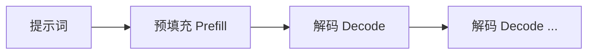
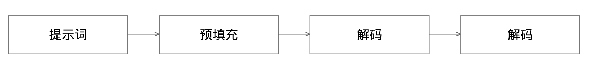
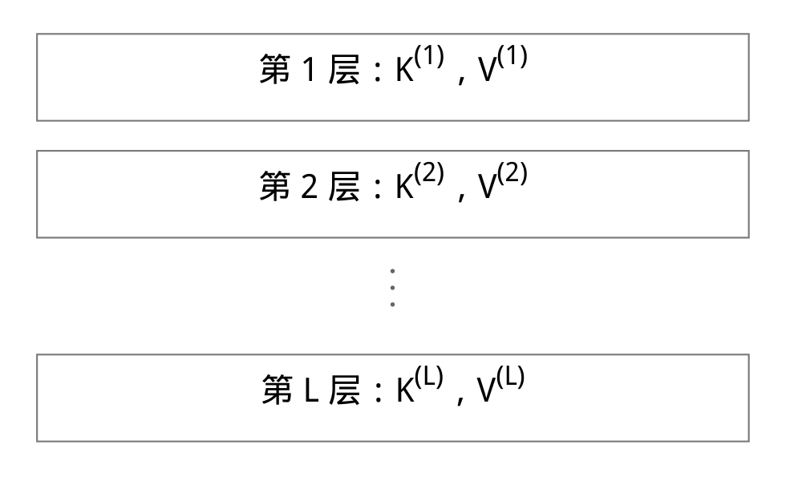
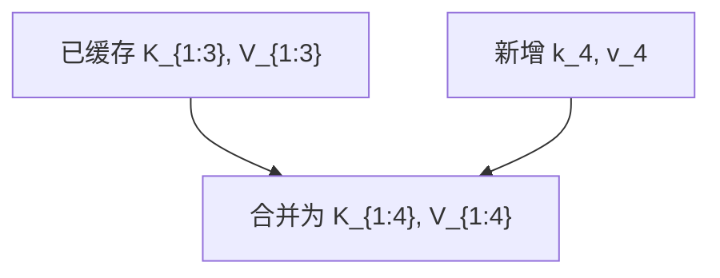
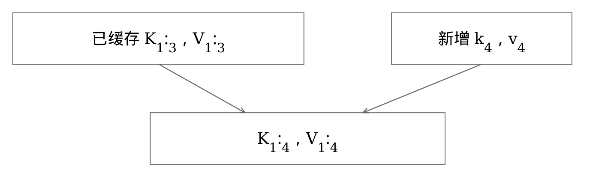
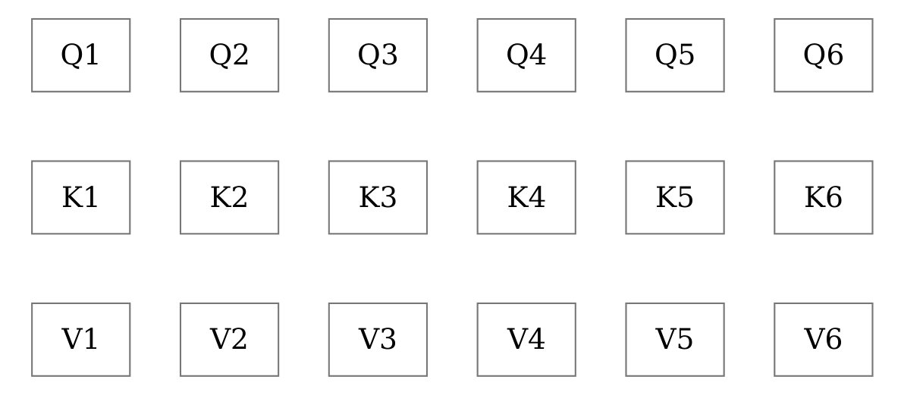
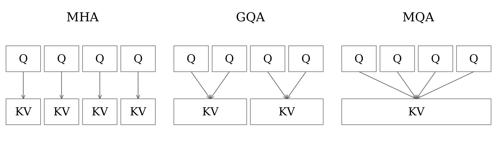
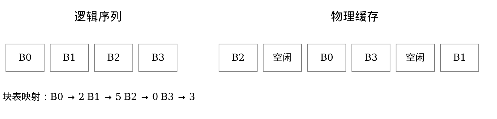

# 理解 KV 缓存 (KV Cache)
## 从自回归解码到现代大语言模型推理

> **面向 AI 工程师、开发者与深入学习者的简明技术手册**  
> **作者**：@techNmak  
> **系列**：手册 02 · Understanding AI 系列 · 中文译本  

---

## 目录

- [导读：本手册将帮你厘清什么](#导读本手册将帮你厘清什么)
  - [前置知识](#前置知识)
- [1 · 自回归生成：为什么解码必须按顺序进行](#1--自回归生成为什么解码必须按顺序进行)
- [2 · 重复计算：朴素的解码器会重复做什么](#2--重复计算朴素的解码器会重复做什么)
- [3 · 工作机制：究竟缓存了什么？](#3--工作机制究竟缓存了什么)
- [4 · 每个注意力层都有自己的缓存：缓存并非单个矩阵](#4--每个注意力层都有自己的缓存缓存并非单个矩阵)
- [5 · 预填充与解码：两个阶段以不同方式创建缓存](#5--预填充与解码两个阶段以不同方式创建缓存)
- [6 · 逐步解码：一个包含四个 token 的例子](#6--逐步解码一个包含四个-token-的例子)
- [7 · 内存公式：KV 缓存有多大？](#7--内存公式kv-缓存有多大)
- [8 · 内存计算实例：在同一个模型中比较 MHA、GQA 和 MQA](#8--内存计算实例在同一个模型中比较-mhagqa-和-mqa)
- [9 · 上下文长度：为什么长上下文会改变推理服务的成本](#9--上下文长度为什么长上下文会改变推理服务的成本)
- [10 · KV 缓存节省了什么：以及它没有节省什么](#10--kv-缓存节省了什么以及它没有节省什么)
- [11 · 多头注意力：KV 状态成本较高的基线方案](#11--多头注意力kv-状态成本较高的基线方案)
- [12 · 多查询注意力：让多个查询头共享 K/V](#12--多查询注意力让多个查询头共享-kv)
- [13 · 分组查询注意力：MHA 与 MQA 之间的折中](#13--分组查询注意力mha-与-mqa-之间的折中)
- [14 · 一个公式，三种架构：为什么 KV 头数如此重要](#14--一个公式三种架构为什么-kv-头数如此重要)
- [15 · 多头潜在注意力：不仅共享头，还压缩表示](#15--多头潜在注意力不仅共享头还压缩表示)
- [16 · 位置信息：RoPE 与缓存的键如何配合？](#16--位置信息rope-与缓存的键如何配合)
- [17 · 从单个请求到整台服务器：为什么缓存管理会变得复杂](#17--从单个请求到整台服务器为什么缓存管理会变得复杂)
- [18 · 碎片化：为什么连续分配会浪费容量](#18--碎片化为什么连续分配会浪费容量)
- [19 · PagedAttention：逻辑序列与不连续的物理块](#19--pagedattention逻辑序列与不连续的物理块)
- [20 · 块大小：分页也有自己的取舍](#20--块大小分页也有自己的取舍)
- [21 · 前缀缓存：跨请求复用预填充状态](#21--前缀缓存跨请求复用预填充状态)
- [22 · 前缀缓存的局限：减少预填充工作，不减少后续解码工作](#22--前缀缓存的局限减少预填充工作不减少后续解码工作)
- [23 · 前缀缓存安全：复用可能通过耗时差异泄露信息](#23--前缀缓存安全复用可能通过耗时差异泄露信息)
- [24 · 淘汰：GPU 缓存满了会怎样？](#24--淘汰gpu-缓存满了会怎样)
- [25 · 卸载：用较慢的内存或存储扩展缓存层级](#25--卸载用较慢的内存或存储扩展缓存层级)
- [26 · KV 缓存量化：用更少的比特存储 K/V](#26--kv-缓存量化用更少的比特存储-kv)
- [27 · 量化并非没有代价：压缩会改变数值状态](#27--量化并非没有代价压缩会改变数值状态)
- [28 · 常见误解：哪些简略说法会让人理解偏差](#28--常见误解哪些简略说法会让人理解偏差)
- [29 · 面向生产环境的理解框架：审视任何 KV 缓存设计时要问的五个问题](#29--面向生产环境的理解框架审视任何-kv-缓存设计时要问的五个问题)
- [30 · 完整的理解框架：用一条逻辑链串起 KV 缓存](#30--完整的理解框架用一条逻辑链串起-kv-缓存)
- [参考文献：主要论文与现行实现资料](#参考文献主要论文与现行实现资料)

---

## 导读：本手册将帮你厘清什么

KV 缓存很容易被解释得不准确。人们常把它称为“大语言模型的记忆”“一种提速技巧”，或干脆称作“缓存起来的注意力”。这些简略说法掩盖了真正重要的机制。

本手册从基本原理出发构建这一概念。读完之后，你应该能够解释：

- **为什么在普通的因果 Transformer 中，过去的键和值可以复用；**
- **缓存中究竟存储了哪些张量，以及它们的形状如何增长；**
- **为什么缓存的内存占用与缓存 token 数、层数、KV 头数、头维度，以及每个元素的字节数成线性关系；**
- **为什么 MQA、GQA 和 MLA 以不同的方式降低 KV 成本；**
- **为什么在并发推理服务中，缓存管理会成为一个系统问题；**
- **PagedAttention、前缀缓存、卸载，以及 KV 缓存量化究竟改变了什么。**

### 前置知识

你应当已经了解基本的注意力公式，以及 $Q$、$K$、$V$ 各自的作用。前一本手册《理解注意力》（*Understanding Attention*）是合适的前置读物。

目标不是再记住一种优化方法，而是理解：**它为什么在数学上成立，节省了什么资源，以及仍然存在哪些成本。**

> 参考资料：`[1]`、`[2]`、`[5]`、`[6]`

---

## 1 · 自回归生成：为什么解码必须按顺序进行

仅解码器（Decoder-only）语言模型会根据已有的 token，给出下一个 token 的概率分布：

$$p(x_{t+1} \mid x_{1:t})$$

选出一个 token 后，就将它追加到序列末尾，成为下一步的上下文。因此，生成过程形成了一条依赖链：

$$x_1, \dots, x_t \longrightarrow x_{t+1} \longrightarrow x_{t+2} \longrightarrow \cdots$$

### 两个执行阶段

- **预填充（Prefill）阶段**：对于包含多个 token 的提示词，模型可以在因果掩码约束下，并行处理这些提示词位置。
- **解码（Decode）阶段**：生成开始之后，模型通常在每个解码步骤中，为每条序列推进一个新生成的 token。





正是这种顺序解码结构，使 KV 缓存变得至关重要。

> 参考资料：`[1]`、`[6]`

---

## 2 · 重复计算：朴素的解码器会重复做什么

考虑一个自注意力层。对于每个 token 的表示，该层通过学习得到的投影矩阵计算：

$$q_i = h_i W_Q, \quad k_i = h_i W_K, \quad v_i = h_i W_V$$

在解码步骤 $t$，新的查询必须关注位置 $1, \dots, t$ 的键和值。

一种朴素实现可能在每一步都从头重新生成旧的 $k_i$ 和 $v_i$ 张量。这样就会反复执行输入并未发生变化的投影计算。

### 一个关键观察

对于普通的因果 Transformer，在固定的某一层中，位置 $i$ 一旦处理完毕，之后追加的 token 就不会反过来改变该位置的层状态。因果掩码阻止未来位置的信息向后流入较早 token 的表示中。

因此，可以保留先前位置生成的键和值，并在后续解码步骤中复用。

> [!IMPORTANT]
> **核心原理**：KV 缓存之所以成立，是因为在模型的因果计算中，过去的层状态不会随未来 token 的加入而改变。它并不是一种启发式猜测。

> 参考资料：`[1]`、`[6]`

---

## 3 · 工作机制：究竟缓存了什么？

假设模型已经处理了位置 $1, \dots, t-1$。在某个注意力层中，已经存储了：

$$K_{1:t-1} = [k_1; \dots; k_{t-1}], \quad V_{1:t-1} = [v_1; \dots; v_{t-1}]$$

对于新位置 $t$，该层只计算新的投影：

$$q_t, \quad k_t, \quad v_t$$

然后追加新的键和值：

$$K_{1:t} = [K_{1:t-1}; k_t], \quad V_{1:t} = [V_{1:t-1}; v_t]$$

当前查询对累积的历史进行注意力计算：

$$\text{softmax}\left(\frac{q_t K_{1:t}^T}{\sqrt{d_h}}\right) V_{1:t}$$

### 这种缓存不存储什么

缓存不存储“思想”或符号化的事实。它存储的是**各个注意力层中、各个已缓存 token 位置的数值化键／值状态**，并按照推理引擎使用的物理布局组织。

> 参考资料：`[1]`、`[6]`

---

## 4 · 每个注意力层都有自己的缓存：缓存并非单个矩阵

每个自注意力层都有自己学习得到的投影，因此也有自己的 K/V 状态。一个拥有 $L$ 个注意力层的模型，会维护如下逻辑历史：

```
第 1 层：K(1), V(1)
第 2 层：K(2), V(2)
       ⋮
第 L 层：K(L), V(L)
```



在一种常见的逻辑布局中，可以把某一层的缓存理解为：

$$K, V \in \mathbb{R}^{B \times H_{KV} \times T \times D_h}$$

其中：
- $B$：批大小（Batch size）
- $H_{KV}$：键／值头数（Number of KV heads）
- $T$：已缓存的序列长度（Cached sequence length）
- $D_h$：头维度（Head dimension）

实际内核可能以不同方式存储或打包这些维度。**理解逻辑形状才是关键；具体的物理布局属于实现细节。**

> 参考资料：`[2]`、`[6]`

---

## 5 · 预填充与解码：两个阶段以不同方式创建缓存

### 预填充（Prefill）
给定输入提示词，模型在因果掩码约束下，于每一层并行计算多个提示词位置的 K/V 状态。这些状态构成初始缓存。

### 解码（Decode）
对于每个新生成的 token，每一层计算新的 $q_t, k_t, v_t$，追加 $k_t, v_t$，然后用新查询对缓存的历史进行注意力计算。

| 维度 | 预填充 (Prefill) | 解码 (Decode) |
| :--- | :--- | :--- |
| **新处理的位置** | 多个提示词 token | 通常每条序列每步一个新 token |
| **缓存操作** | 建立初始 K/V 历史 | 追加新的 K/V 状态 |
| **注意力查询长度** | 多个 | 通常为 1 |
| **复用收益** | 建立状态 | 避免重复计算过去的 K/V 投影 |

> [!NOTE]
> KV 缓存并没有消除对历史信息的注意力计算。在稠密注意力中，新查询仍然需要与过去的 K/V 状态交互。

> 参考资料：`[6]`、`[7]`

---

## 6 · 逐步解码：一个包含四个 token 的例子

假设缓存目前包含位置 $1 \sim 3$。在下一步中：

1. 模型接收 token 4 在当前层的表示。
2. 计算 $q_4$、$k_4$ 和 $v_4$。
3. 将 $k_4$ 和 $v_4$ 追加到该层缓存中。
4. 将 $q_4$ 与 $K_{1:4}$ 进行比较。
5. 用得到的注意力权重对 $V_{1:4}$ 加权混合。
6. 该层输出供模型后续部分使用的表示。

旧的 $k_1, k_2, k_3$ 和 $v_1, v_2, v_3$ 会被读取，而不必重新生成。





> 参考资料：`[6]`

---

## 7 · 内存公式：KV 缓存有多大？

对于 KV 头数和头维度一致的常规稠密注意力堆叠，单条序列的理想化缓存大小为：

$$M_{KV} = 2 \cdot L \cdot T \cdot H_{KV} \cdot D_h \cdot b$$

其中：
- **$2$**：同时计入 $K$ 和 $V$；
- **$L$**：注意力层数；
- **$T$**：已缓存的 token 数；
- **$H_{KV}$**：键／值头数；
- **$D_h$**：头维度；
- **$b$**：每个已存储元素占用的字节数（bytes per element，如 FP16 为 2，FP8 为 1）。

对于 $B$ 条等长序列，将结果乘以 $B$。更一般地，当各条序列的缓存长度为 $T_i$ 时，理想化的有效数据量为：

$$M_{KV} = 2 \cdot L \cdot H_{KV} \cdot D_h \cdot b \sum_{i=1}^{B} T_i$$

> [!NOTE]
> 真实的推理服务引擎会按块分配内存，还可能加入填充、缩放因子、元数据、分片，或模型特有的状态。因此，这些公式描述的是**张量有效数据量**，并不涵盖运行时消耗的每一个字节。

这个公式的价值在于，各种架构选择的影响一目了然：
- 上下文长度改变 $T$；
- MQA/GQA 改变 $H_{KV}$；
- 缓存量化改变存储项 $b$，同时还会增加量化元数据。

> 参考资料：`[2]`、`[3]`、`[4]`、`[5]`

---

## 8 · 内存计算实例：在同一个模型中比较 MHA、GQA 和 MQA

以一个示例解码器为例，其配置为：

$$L = 32, \quad D_h = 128, \quad b = 2\text{ bytes (FP16/BF16)}, \quad H_Q = 32$$

我们只改变 $H_{KV}$ 的值：

| 架构 | $H_{KV}$ | KiB / token | 8,192 token 时显存占用 (GiB) |
| :--- | :--- | :--- | :--- |
| **MHA** | 32 | 512 | 4.000 |
| **GQA（示例）** | 8 | 128 | 1.000 |
| **MQA** | 1 | 16 | 0.125 |

对于 GQA（$H_{KV}=8$）这一行计算：

$$2 \times 32 \times 8192 \times 8 \times 128 \times 2 = 1,073,741,824\text{ bytes} = 1\text{ GiB}$$

这些是单条序列的张量有效数据量示例，并不代表所有 32 层模型的通用大小。不同模型的层数、KV 头数、维度、数据类型、局部注意力模式以及分片方式都可能不同。

> 参考资料：`[2]`、`[3]`

---

## 9 · 上下文长度：为什么长上下文会改变推理服务的成本

保持其他条件不变时：

$$M_{KV} \propto T$$

这意味着，已缓存的 token 数翻倍，理想化的 KV 张量有效数据量也会翻倍。

沿用上一页的示例模型：

| 架构 | 8K 上下文 | 32K 上下文 | 128K 上下文 |
| :--- | :--- | :--- | :--- |
| **MHA ($H_{KV} = 32$)** | 4 GiB | 16 GiB | 64 GiB |
| **GQA ($H_{KV} = 8$)** | 1 GiB | 4 GiB | 16 GiB |
| **MQA ($H_{KV} = 1$)** | 0.125 GiB | 0.5 GiB | 2 GiB |

单个请求的上下文变长，并不会使模型参数占用的内存随之增长，但该请求的 KV 状态会增长。因此，即使模型权重不变，长上下文能力也会带来推理服务容量问题。

> [!WARNING]
> **核心洞察**：上下文窗口规格告诉你模型能接受多长的输入，却不能告诉你某台服务器能同时容纳多少个长上下文请求。

> 参考资料：`[5]`、`[7]`

---

## 10 · KV 缓存节省了什么：以及它没有节省什么

KV 缓存避免了重复计算历史键／值投影，以及生成这些投影所需的先前层状态。这大幅减少了自回归解码中的重复工作。

但对于普通的稠密注意力，新查询仍然需要访问过去的 K/V 状态。随着 $T$ 增大，新位置的注意力操作仍然需要与更长的历史交互。

### 三种不同的资源

不要把它们混为一谈：

1. **计算（Compute）**：投影和注意力所需的算术运算。
2. **容量（Capacity）**：让 K/V 状态驻留在内存中所需的字节数。
3. **内存流量／带宽（Memory Traffic / Bandwidth）**：解码期间，为注意力内核提供数据所需搬运的字节数。

> [!IMPORTANT]
> MQA 的明确动机，是**降低增量解码期间反复加载大型 K/V 张量所产生的内存带宽成本**，而不只是“减少参数量”。

> 参考资料：`[2]`

---

## 11 · 多头注意力：KV 状态成本较高的基线方案

在标准多头注意力（Multi-Head Attention，MHA）中，每个查询头都有对应的键头和值头。从概念上看：

$$H_{KV} = H_Q$$

如果有 32 个查询头，就有 32 个键头和 32 个值头。

在解码期间，每个新查询头都会关注其对应头的历史 K/V 状态。这使架构拥有丰富的逐头 K/V 投影，但也让 KV 缓存随着 KV 头数成正比增长。

```
Q1    Q2    Q3    Q4    Q5    Q6
K1    K2    K3    K4    K5    K6
V1    V2    V3    V4    V5    V6
```



这一页给出了理解 MQA 和 GQA 所需的基线。

> 参考资料：`[1]`、`[2]`

---

## 12 · 多查询注意力：让多个查询头共享 K/V

多查询注意力（Multi-Query Attention，MQA）保留多个查询头，但让它们共享一个键头和一个值头：

$$H_Q > 1, \quad H_{KV} = 1$$

Noam Shazeer 在 2019 年的论文中，专门围绕增量解码提出这一改动：**加载 K/V 张量可能成为内存带宽瓶颈，因此缩小这些张量可以提高解码效率。**

### 发生了什么变化
各查询头仍然彼此独立。节省来自 K/V 共享，而非删除查询头。

### 缓存公式告诉我们什么
如果一个有 32 个查询头／KV 头的 MHA 模型改为只使用一个 KV 头，同时保持 $L, D_h, T, b$ 不变，那么 KV 张量有效数据量将缩小为原来的 **1/32**。

这个计算结果是架构变化的直接后果。但某个具体 MQA 模型相对于某个 MHA 基线，是否能保持质量，需要通过实验验证，并没有数学保证。

> 参考资料：`[2]`

---

## 13 · 分组查询注意力：MHA 与 MQA 之间的折中

分组查询注意力（Grouped-Query Attention，GQA）的 KV 头数少于查询头数，但大于一个：

$$1 < H_{KV} < H_Q$$

查询头被划分为若干组，同一组中的查询头共享同一组 K/V 头。

| 特性 | MHA | GQA | MQA |
| :--- | :--- | :--- | :--- |
| **查询头** | 多个 | 多个 | 多个 |
| **KV 头** | 与 Q 相同 | 介于两者之间 | 1 |
| **K/V 共享** | 查询头之间不共享 | 组内共享 | 所有查询头共享 |

Ainslie 等人将 GQA 作为 MQA 的推广提出。论文报告，在他们的实验中，经追加训练转换得到的 GQA 模型，质量接近 MHA，速度则与 MQA 相当。

> [!NOTE]
> “GQA 和 MHA 一样好”过于宽泛。严谨的说法应限定在 GQA 论文报告的模型和实验设置之内。

> 参考资料：`[3]`

---

## 14 · 一个公式，三种架构：为什么 KV 头数如此重要

当 $L, T, D_h, b$ 固定时：

$$M_{KV} \propto H_{KV}$$

因此，是否共享头、如何共享，会直接体现在内存占用上。



这就是为什么讨论 KV 缓存时不能脱离注意力架构。即使参数规模和上下文长度相同，不同模型也可能因为 K/V 表示方式不同，而具有截然不同的缓存需求。

> 参考资料：`[2]`、`[3]`

---

## 15 · 多头潜在注意力：不仅共享头，还压缩表示

DeepSeek-V2 提出了**多头潜在注意力（Multi-head Latent Attention，MLA）**，为降低 KV 缓存成本提供了另一条路径。

其核心思路是：用一个更低维的潜在状态（Latent State），表示 K/V 中的非位置相关信息。推理时，借助投影吸收，模型无需按照传统方式显式生成并缓存完整的逐头 K/V 张量。

这在概念上不同于 MQA/GQA：
- **MQA**：共享一组 K/V 头；
- **GQA**：使用较少数量的共享 K/V 头；
- **MLA**：对 K/V 信息进行低秩潜在压缩（Low-rank latent compression）。

DeepSeek-V2 报告，相对于其指定的对比架构，KV 缓存减少了 **93.3%**。这个数值是该论文的特定结果，并非通用的“MLA 压缩比”。

### RoPE 带来的复杂性
DeepSeek-V2 还使用了解耦的旋转位置分量，因为普通 RoPE 会影响 MLA 所采用的投影吸收策略。因此，只说“MLA 缓存一个很小的向量”并不完整。

> 参考资料：`[4]`

---

## 16 · 位置信息：RoPE 与缓存的键如何配合？

在标准旋转位置嵌入（RoPE）中，会先对查询和键施加与位置相关的旋转，再使用它们的点积进行注意力计算。在普通的缓存解码过程中，为后续复用而存储的历史键，必须与后续查询所预期的位置处理方式保持一致。

从实现层面，可以这样理解：
1. 为新位置计算新的键；
2. 按照注意力实现的要求，应用模型的位置变换；
3. 以未来注意力调用所预期的形式，存储／复用键的表示。

不同架构可能改变具体的存储内容。MLA 是最明显的例子：与常规 MHA/GQA 模型相比，其解耦的位置分量改变了缓存结构。

> [!IMPORTANT]
> 不要把“KV 缓存总是存储经过 RoPE 处理的 K”当作通用定义。缓存表示取决于具体架构和系统实现。

> 参考资料：`[4]`、`[6]`

---

## 17 · 从单个请求到整台服务器：为什么缓存管理会变得复杂

单个请求的情况很简单：随着 token 被处理，其缓存不断增长。而推理服务系统中有许多请求，它们的提示词长度、生成长度、到达时间和完成时间各不相同。

在任意时刻，服务器可能需要同时管理：
- 一条刚刚开始的序列；
- 另一条已经缓存了数万个 token 的序列；
- 若干即将完成并释放内存的请求；
- 共享前缀的请求；
- 需要不同注意力窗口模式的请求。

这使 KV 缓存从一个单纯的张量问题，变成了**动态内存管理系统问题**。

PagedAttention 论文指出，在当时的推理服务系统中，碎片化和冗余副本是浪费 KV 缓存容量的主要原因。因此，论文借鉴虚拟内存，提出了一种基于块的设计。

> 参考资料：`[5]`

---

## 18 · 碎片化：为什么连续分配会浪费容量

如果每个请求都需要一块大型连续 KV 内存，并按可能达到的最大序列长度预先分配，就可能出现两种浪费：

### 预留但未使用的空间（内部碎片 / Over-reservation）
请求可能预留了一些最终永远用不到的空间。

### 外部碎片（External Fragmentation）
空闲内存可能分散成若干小块。即使总量足够，每一块也可能太小，无法满足一次大型连续内存申请。

PagedAttention 不再要求每条逻辑序列的 KV 状态都存放在同一片连续的物理区域中。它将缓存状态划分为固定大小的块，并把逻辑块映射到物理块。

> [!NOTE]
> **关键区分**：分页解决的是**内存管理问题**。不要将它与 **FlashAttention** 混淆，后者主要是一种面向 IO 优化的注意力计算算法与 GPU 显存层次内核策略。

> 参考资料：`[5]`

---

## 19 · PagedAttention：逻辑序列与不连续的物理块

PagedAttention 将一种来自操作系统的思路应用于 KV 状态：**把序列划分为逻辑 token 块，再将这些逻辑块放入任意可用的物理 KV 缓存块**。



- **逻辑序列**：$B_0 \longrightarrow B_1 \longrightarrow B_2 \longrightarrow B_3$
- **物理缓存分布**：$[B_2] \quad [空闲] \quad [B_0] \quad [B_3] \quad [空闲] \quad [B_1]$
- **块表映射（Block Table）**：$B_0 \to 2, \quad B_1 \to 5, \quad B_2 \to 0, \quad B_3 \to 3$

块表告诉注意力实现，每个逻辑块具体位于何处。随着请求增长，可以继续分配新块；不再需要时，就释放这些块。

最初的 vLLM 工作还通过块共享（写时复制 Copy-on-Write），减少相关序列（如 Beam Search、多样本采样）之间的重复数据。

> 参考资料：`[5]`

---

## 20 · 块大小：分页也有自己的取舍

一个 KV 块代表固定数量的 token 位置（Block size）。

- **较小的块**：可以减少序列尾部的内部空间浪费，也能让复用粒度更细。
- **较大的块**：可以减少管理开销，并且可能更适合某些内核设计或内存传输方式。

不存在一种脱离引擎、硬件、工作负载、模型和内核设计，却普遍最优的块大小。

现代推理服务系统提供面向块的缓存管理器。但其具体默认值和物理打包方式，应当视为实现细节，而非 KV 缓存定义的一部分。

> [!IMPORTANT]
> **值得长期记住的核心思想**：  
> **逻辑 token 历史 $\neq$ 一块连续的物理内存**  
> 这种分离使运行时可以按块分配、共享、淘汰和移动缓存状态。

> 参考资料：`[5]`、`[7]`

---

## 21 · 前缀缓存：跨请求复用预填充状态

普通 KV 缓存会在一个进行中的请求内部复用先前状态。

前缀缓存（Prefix Caching）则更进一步：如果后续请求具有可复用的前缀，并与之前计算的状态匹配，服务器就可以复用该前缀的 KV 缓存块，而不必重新执行它的预填充计算。

当前的 vLLM 使用块哈希实现自动前缀缓存。哈希基于前缀和块内容，并在正确性需要时纳入额外输入，例如模型／运行时特有的上下文。

### 两类受益的工作负载
1. **长文档或固定 Prompt 问答**：围绕同一份长文档或同一个系统提示词，反复提出问题；
2. **多轮对话（Multi-turn Chat）**：多轮对话中，把大量历史内容反复作为前缀发送。

> [!NOTE]
> 前缀缓存是对匹配计算前缀的**精确状态复用**。它不是语义相似度搜索，也不是 RAG。

> 参考资料：`[7]`

---

## 22 · 前缀缓存的局限：减少预填充工作，不减少后续解码工作

前缀缓存可以跳过已经处理过的共享前缀计算。一旦生成超出该前缀，新的 token 仍然需要正常解码。

当前 vLLM 文档明确指出：自动前缀缓存可以减少查询处理／预填充时间，但**不会减少解码阶段生成新 token 所需的时间**。

这意味着，如果某类工作负载的大部分时间都用来生成很长的回答，那么即使其提示词前缀可以复用，整体耗时收益也可能很小。

### 保证正确性，不只是匹配文本
安全的缓存键可能需要区分可见 token 文本以外的更多信息：模型身份及配置、适配器（LoRA）、多模态输入，或其他执行状态，都可能影响一个缓存块能否复用。具体要求取决于运行时。

> 参考资料：`[7]`

---

## 23 · 前缀缓存安全：复用可能通过耗时差异泄露信息

在多租户服务中，缓存命中可能显著改变延迟。如果允许无关用户共享前缀缓存状态，攻击者就可能通过观察耗时差异，推断某些内容是否已经被缓存（时序侧信道攻击 Timing Side-Channel）。

当前 vLLM 提供可选的逐请求 `cache_salt`。这个盐值会被纳入第一个块的缓存标识，使得只有使用相同盐值的请求才能复用这些块，从而为缓存共享建立信任边界。

同样的工程原则并不限于某一个框架：

> [!CAUTION]
> **核心安全原则**：缓存复用范围，应当与信任范围一致。

哈希算法的选择也很重要：当前 vLLM 文档警告，非密码学哈希会增加碰撞风险，并可能在共享环境中造成计算正确性或隐私隔离问题。

> 参考资料：`[7]`

---

## 24 · 淘汰：GPU 缓存满了会怎样？

生产环境中的缓存容量有限。当需要新的 K/V 块时，旧的可复用块可能必须移出 GPU 内存。

不存在一种通用的淘汰策略。常见例子包括：
- 对可复用前缀块采用类似 LRU（最近最少使用）的淘汰方式；
- 考虑优先级的 LRU 变体；
- 保护正在解码的请求所占用块的策略；
- 在可扩展卸载系统中，由应用自定义的策略。

当前 vLLM 的前缀缓存设计文档描述了基于 LRU 的释放／淘汰路径。当前 TensorRT-LLM 文档则描述了针对可复用块的优先级 LRU 策略。

淘汰可复用前缀块不会改变模型的计算正确性，它只会影响后续请求能否免于重新计算该状态。淘汰活动序列所必需的缓存则是另一回事，必须由运行时协调处理。

> 参考资料：`[7]`、`[8]`

---

## 25 · 卸载：用较慢的内存或存储扩展缓存层级

当 GPU 显存紧张时，可以将可复用的 KV 块移动到容量更大、速度更慢的存储中，需要时再调回。

一种常见的层级结构是：

$$\text{GPU HBM} \longleftrightarrow \text{CPU 内存} \longleftrightarrow \text{次级存储 / 网络层}$$

当前 vLLM 支持将 KV 卸载到 CPU，也支持多层卸载设计，其中次级存储层通过 CPU 内存中转。当前 TensorRT-LLM 可以将可复用块卸载到主机内存，并提供连接器，用于外部 KV 缓存存储或传输。

### 核心权衡
卸载扩大了有效缓存容量，但也引入了数据搬运。它是否有帮助，取决于：
- 复用概率；
- 传输带宽与延迟；
- 传输和计算的重叠程度；
- 重新计算该状态的成本。

> [!IMPORTANT]
> “卸载到 CPU 以节省 GPU 内存”并不是完整的判断。真正需要决定的是：**传输缓存状态，还是重新计算它？**

> 参考资料：`[8]`、`[9]`

---

## 26 · KV 缓存量化：用更少的比特存储 K/V

另一种降低缓存容量和带宽压力的方法，是以较低精度存储 K/V 激活值。

从概念上讲，如果张量有效数据从 16 位存储改为理想的 8 位存储，元素存储部分就会减半。

真实实现还需要缩放因子、对齐、元数据，以及后端特有的布局，因此实际节省的内存未必恰好等于理想位宽比例。

当前 vLLM 支持多种 KV 缓存存储数据类型，包括在受支持硬件／后端上的 FP8 变体。文档还说明了量化缩放因子的校准途径。

KVQuant 等研究系统探索了更低比特（如 4-bit / 3-bit / 2-bit）的 KV 表示，但它们报告的准确率／吞吐量结果，取决于具体方法、模型、硬件和基准测试。

> 参考资料：`[10]`、`[11]`

---

## 27 · 量化并非没有代价：压缩会改变数值状态

与 PagedAttention 的内存放置方式或精确前缀复用不同，KV 缓存量化改变了缓存张量的**数值表示**。

这会在后续注意力计算中引入量化误差。工程上需要权衡：

$$\text{节省的内存 / 带宽} \quad \longleftrightarrow \quad \text{模型质量及内核计算成本}$$

合适的精度可能取决于：
- 模型架构与各层的敏感程度；
- 键／值激活值的分布；
- 上下文长度；
- 量化粒度与缩放因子；
- 硬件支持与可用内核。

当前 vLLM 甚至允许选定的层或注意力类型不进行量化，而其他部分使用低精度 KV 数据类型。这反映出，不同部分的敏感程度未必相同。

> 参考资料：`[10]`、`[11]`

---

## 28 · 常见误解：哪些简略说法会让人理解偏差

| 常见说法（误解） | 正确认知（真实现状） |
| :--- | :--- |
| **“KV 缓存就是模型的记忆。”** | **不对**。它是在注意力层中，根据 token 序列生成的临时推理状态，并不存储事实或记忆。 |
| **“KV 缓存让解码变成常数时间。”** | **不对**。它避免重复计算历史 K/V 投影；新查询的稠密注意力仍然需要与不断增长的历史交互（复杂度仍随步数增长）。 |
| **“MQA/GQA 减少了查询头。”** | **不对**。它们的定义性变化，是相对于查询头而言，K/V 头的数量与共享方式发生了改变，查询头数量并未减少。 |
| **“PagedAttention 就是 FlashAttention。”** | **不对**。PagedAttention 解决 KV 缓存的显存管理与碎片化问题；FlashAttention 解决高效注意力计算及 IO 内存流量问题。 |
| **“前缀缓存会加速每个生成的 token。”** | **不对**。它可以跳过可复用前缀的预填充阶段，但并未消除后续生成新 token 的正常解码工作。 |
| **“KV 量化是无损压缩。”** | **通常不是**。较低精度的表示会引入数值近似与量化误差，必须权衡模型输出精度与吞吐量。 |

> 参考资料：`[2]`、`[5]`、`[7]`、`[10]`

---

## 29 · 面向生产环境的理解框架：审视任何 KV 缓存设计时要问的五个问题

在评估任何大模型推理系统或架构的 KV 缓存设计时，提出以下五个关键问题：

1. **存储什么？**
   - 存储哪些 K/V 或潜在状态，位于哪些层，使用什么数据类型／物理布局？
2. **每个 token 会创建多少状态？**
   - 关注 $L$、$H_{KV}$、$D_h$、存储字节数、注意力窗口规则以及模型分片（TP/PP）方式。
3. **状态存放在哪里？**
   - 连续的 GPU 显存张量、分页块、CPU 内存卸载、远程分布式缓存，还是多级存储架构？
4. **什么时候可以复用？**
   - 在单个请求内部、匹配前缀之间、不同实例之间，还是根本无法复用？
5. **瓶颈是什么？**
   - GPU 显存容量、显存内存带宽（Memory Bandwidth）、传输延迟、重复计算、显存碎片化，还是系统调度器开销？

这些问题可以帮助我们，将 **KV 缓存的数学机制**，与围绕它构建的**推理服务系统**区分开来。

> 参考资料：`[5]`、`[7]`、`[8]`、`[9]`

---

## 30 · 完整的理解框架：用一条逻辑链串起 KV 缓存

因果 Transformer 不断根据先前的 token 生成新 token。追加未来 token 时，过去的注意力层状态不会改变，因此模型可以保留它们的键和值，而不必重新计算。

对于常规缓存，张量有效数据量大致按下式增长：

$$2 \cdot L \cdot T \cdot H_{KV} \cdot D_h \cdot b$$

这使长上下文和高并发请求的显存成本极高：
- **MQA / GQA** 减少 KV 头数；
- **MLA** 压缩缓存表示（低秩潜在向量）；
- **低精度量化存储** 减少每个元素的字节数。

在大规模推理服务中，动态变化的序列长度带来分配与复用难题：
- **基于块的缓存管理（PagedAttention）**：将逻辑 token 历史与物理内存位置解耦，根治碎片化；
- **前缀缓存（Prefix Caching）**：让兼容请求能够跨会话复用已经计算过的预填充状态；
- **淘汰与卸载（Eviction & Offloading）**：决定哪些可复用块继续保留在靠近 GPU 的层级，平衡数据搬运与重算成本；
- **量化（Quantization）**：以微小的数值精度代价，换取成倍的容量与带宽节省。

> [!IMPORTANT]
> **总结**：**KV 缓存既是因果注意力带来的数学结果，也是模型架构的设计约束，还是运行时的系统内存管理问题。** 理解这三个层面，才能真正用好这个概念。

> 参考资料：`[1]`—`[11]`

---

## 参考文献：主要论文与现行实现资料

- **[1]** A. Vaswani 等。*Attention Is All You Need*（《注意力就是你所需要的一切》）。NeurIPS 2017。[arXiv:1706.03762](https://arxiv.org/abs/1706.03762)。
- **[2]** N. Shazeer。*Fast Transformer Decoding: One Write-Head is All You Need*（《快速 Transformer 解码：只需一个写入头》）。2019。[arXiv:1911.02150](https://arxiv.org/abs/1911.02150)。
- **[3]** J. Ainslie 等。*GQA: Training Generalized Multi-Query Transformer Models from Multi-Head Checkpoints*（《GQA：从多头模型检查点训练广义多查询 Transformer 模型》）。EMNLP 2023。[arXiv:2305.13245](https://arxiv.org/abs/2305.13245)。
- **[4]** DeepSeek-AI 等。*DeepSeek-V2: A Strong, Economical, and Efficient Mixture-of-Experts Language Model*（《DeepSeek-V2：强大、经济且高效的混合专家语言模型》）。2024。[arXiv:2405.04434](https://arxiv.org/abs/2405.04434)。
- **[5]** W. Kwon 等。*Efficient Memory Management for Large Language Model Serving with PagedAttention*（《使用 PagedAttention 高效管理大语言模型推理服务的内存》）。SOSP 2023。DOI: [10.1145/3600006.3613165](https://doi.org/10.1145/3600006.3613165)；[arXiv:2309.06180](https://arxiv.org/abs/2309.06180)。
- **[6]** NVIDIA Transformer Engine 文档。PyTorch 注意力／推理参数；解码期间的 K/V 缓存。查阅于 2026 年 9 月。
- **[7]** vLLM 文档。自动前缀缓存、缓存配置，以及前缀缓存隔离／安全。现行文档查阅于 2026 年 9 月。
- **[8]** NVIDIA TensorRT-LLM 文档。KV 缓存系统、复用、优先级淘汰及主机卸载。现行文档查阅于 2026 年 9 月。
- **[9]** vLLM 文档。KV 卸载使用指南与多层卸载 API。现行文档查阅于 2026 年 9 月。
- **[10]** vLLM 文档。量化 KV 缓存与 CacheConfig 存储数据类型选项。现行文档查阅于 2026 年 9 月。
- **[11]** C. Hooper 等。*KVQuant: Towards 10 Million Context Length LLM Inference with KV Cache Quantization*（《KVQuant：通过 KV 缓存量化迈向千万级上下文长度的大语言模型推理》）。2024。[arXiv:2401.18079](https://arxiv.org/abs/2401.18079)。
